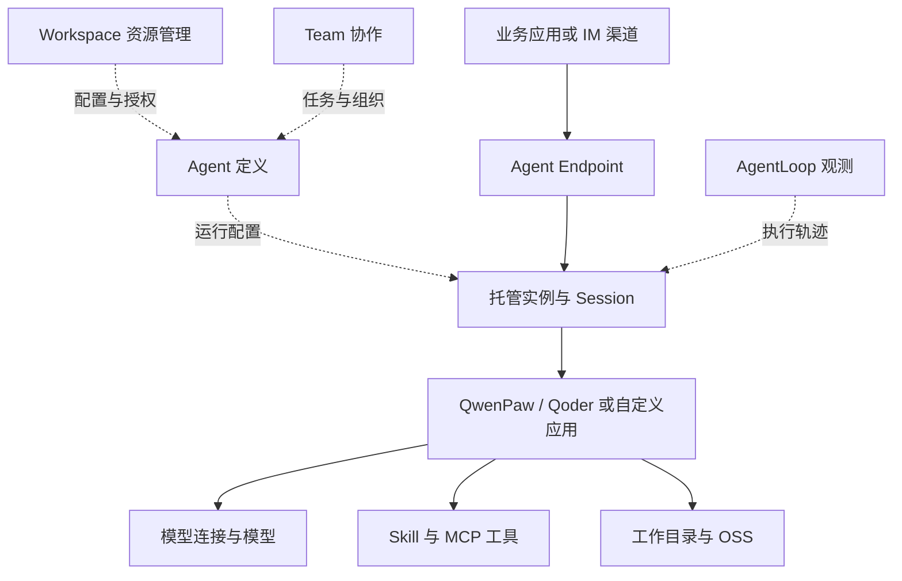

# 阿里云 AgentCore 架构与责任边界

## 官方设计与分析视角

查阅日期：2026-10-10。官方产品概述按构建运行、协作治理、观测评估划分能力；基本概念围绕 Workspace、Agent、Team 与资产描述对象关系。这是产品能力分类，不是按调用依赖排序的底层技术分层。[A1][A2]

以下图是依据公开职责重建的逻辑视图，**不是厂商内部架构图**。Endpoint 表示调用入口，Workspace／Team 表示管理组织，不能认为所有组件都在同一进程或每次调用都经过 Team。

## 逻辑分层

| 逻辑职责 | 可观察的产品对象 | 责任边界 |
|---|---|---|
| 接入 | Endpoint、AG-UI、渠道连接器 | 把业务请求接入 Agent，不等同于模型推理接口 |
| 定义与控制 | Workspace、Agent 模板、角色、资产绑定 | 管理配置、资源归属和访问，非会话计算隔离证据 |
| 执行编排 | Harness、Subagent、Team、自定义代码 | Harness 内循环、子 Agent 与 Team 协作不能视作同一种调度 |
| 资源访问 | 模型、MCP、Skill、凭证、知识库连接与 MemoryStore | 资源存在不代表每种 Harness 自动接入 |
| 运行基础设施 | 实例、Session、VPC、OSS、镜像和健康检查 | 管理运行与存储边界，应用仍承担状态语义 |
| 横向治理 | 权限、Token 配额、Trace | 安全和观测跨多个层次，完整覆盖需验证 |

其中模型、MCP、Skill、记忆与凭证的代码接入由 SDK 提供，但 SDK 不负责镜像构建和平台部署。[A5]

## 关键对象关系

Workspace 是资源组织边界，不应替代运行隔离概念。Agent 可拥有多个实例，实例可承载多个 Session；同实例 Session 共享 CPU 与内存。不同 Session 使用独立工作目录，同时同 Agent 可用 `shared/` 共享文件。目录分离不是独立内核或独立虚拟机的证明。[A3]

**研究判断：**控制面宜管理定义、资产、权限和协作，执行面宜管理入口、运行、上下文和工具动作。公开资料支持这种责任拆分，但尚不能确认阿里云内部已经采用怎样的服务边界或存储拓扑。

## 企业平台借鉴与缺口

可借鉴资源绑定复用、混合 Agent 接入和独立 Session 生命周期。自建平台还需明确 tenant、用户、Agent 和 Session 四种身份之间的映射，并区分历史存储、文件存储、长期记忆和正在执行的任务状态。

需向厂商确认：底层沙箱技术、Team 故障转移、配置快照、凭证注入隔离、平台级审计覆盖、数据删除与保留机制。文档未披露不表示不支持。

## 参考资料

见[来源 A1—A5](sources.md)。返回[产品调研](README.md)。
