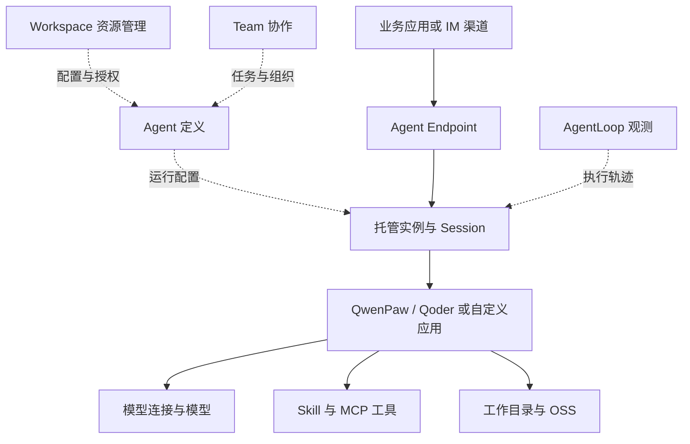

# 阿里云 AgentCore 详细调研

证据基线为 2026-10-10；2026-10-12 调整阅读结构并补充定位与架构分析。未新增部署实验。本次复核 A1 产品概述，其他来源沿用原查阅日期。

[先读摘要](summary.md) · [产品索引](../README.md)

## 阅读路线

从定位与边界开始，继而理解软件组件、典型执行路径和设计取舍；定制、托管与费用用于解释架构的实际边界。图和调用解释是公开资料的研究视图，源码证据只覆盖注明的组件，不推定未公开的内部拓扑。

### 面向谁，核心侧重点是什么

官方定位是智能体构建和治理平台。[A1](https://help.aliyun.com/zh/agentcore/agentcore-product-overview) **研究判断：**其主要软件问题是把来源、引擎和部署方式不同的 Agent 纳入共同的资源组织与管理体系。平台开发者关注资产如何复用，业务团队关注 Agent 如何接入日常工作，运营者关注谁能访问、如何观测和管理。

这个定位使 Workspace、资产绑定和 Team 成为理解产品的重要入口。单个 Agent 的循环只是其中一部分；模型连接不是模型本身，Team 协作也不是单个 Harness 内的子任务调度。把这些概念分开，才能判断产品究竟统一了管理，还是也统一了执行语义。

### 研究背景与结论

本次研究以产品定位和软件架构建立知识基线，配置化定制和运行托管用于解释实际边界。初轮查阅日期为 2026-10-10，依据滚动更新的官方文档，未开通实例、未执行部署或性能实验。`active` 表示文档证据已核对，产品行为仍会演进，不表示完成生产验证。

AgentCore 是阿里云的智能体构建和治理平台。它将工作空间中的 Agent、模型与工具资产、协作和运行配置组织在统一控制台中。AgentCore 是平台，QwenPaw／Qoder 是托管 Harness 的执行引擎，模型连接提供模型访问配置，四者不能混为同一个产品。[A1](https://help.aliyun.com/zh/agentcore/agentcore-product-overview)[A2](https://help.aliyun.com/zh/agentcore/agentcore-basic-concepts)

对企业平台设计最值得借鉴的是资源组织和运行组织的区分：Workspace 组织可复用资产，Agent 描述执行单元，实例承载进程，Session 组织连续交互，Team 组织协作。它提供配置化和代码部署等入口，但不同模式不拥有完全相同的能力。[A2](https://help.aliyun.com/zh/agentcore/agentcore-basic-concepts)[A3](https://help.aliyun.com/zh/agentcore/agent-instructions-managed-harness)

### 产品边界

| 模式 | 用户提供 | 平台负责 | 边界 |
|---|---|---|---|
| 托管 Harness | 引擎选择、角色、模型、绑定资产和资源配置 | Harness 运行和实例／会话管理 | 引擎能力和当前支持项约束定制范围 |
| 高代码 Agent | 应用代码、容器镜像、启动与服务契约 | 镜像托管运行、资源与平台接入 | 应用负责业务逻辑与框架状态 |
| 本地 Agent 纳管 | 已有部署与接入配置 | 统一管理和协作接入 | 纳管不等于云端替用户维护原部署 |

以上来自基本概念和部署指南。注册／纳管功能是否在目标地域可用，须以具体控制台和接入指南确认。[A2](https://help.aliyun.com/zh/agentcore/agentcore-basic-concepts)[A4](https://help.aliyun.com/zh/agentcore/high-code-agent-deployment-guide)

### 本次研究回答

- 架构层次：官方公布能力分组和资源对象，尚未找到完整内部服务拓扑或统一“七层”定义。见[架构分析](detail.md#软件架构)。
- 定制能力：可以配置托管 Harness，也可以编写代码，二者约束不同。见[定制与托管](detail.md#定制与运行边界)。
- 企业托管：包含资源、会话、网络、存储与权限入口，不能据此认定任务断点恢复、业务操作幂等或全部合规要求已由平台完成。
- 开发基础：官方明确 Harness 使用 QwenPaw／Qoder，SDK 适配多个框架。未确认平台直接基于 AgentRun、函数计算或 Kubernetes，未确认平台源自 OpenClaw 或其他产品。

### 适用判断

**研究判断：**已有阿里云资产、需要统一工作空间和办公渠道接入的团队，可优先验证此产品。涉及持久知识、长期记忆或审批的业务，应首先核对具体模式，不能从产品概述的应用场景推导托管 Harness 已支持这些能力。

不对 AWS 与阿里云做性能、稳定性或成本排序，本次没有相同工作负载实验。两家同名不构成代码继承证据。

### 官方设计与分析视角

查阅日期：2026-10-10。官方产品概述按构建运行、协作治理、观测评估划分能力；基本概念围绕 Workspace、Agent、Team 与资产描述对象关系。这是产品能力分类，不是按调用依赖排序的底层技术分层。[A1](https://help.aliyun.com/zh/agentcore/agentcore-product-overview)[A2](https://help.aliyun.com/zh/agentcore/agentcore-basic-concepts)

以下图是依据公开职责重建的逻辑视图，**不是厂商内部架构图**。Endpoint 表示调用入口，Workspace／Team 表示管理组织，不能认为所有组件都在同一进程或每次调用都经过 Team。

### 逻辑分层

| 逻辑职责 | 可观察的产品对象 | 责任边界 |
|---|---|---|
| 接入 | Endpoint、AG-UI、渠道连接器 | 把业务请求接入 Agent，不等同于模型推理接口 |
| 定义与控制 | Workspace、Agent 模板、角色、资产绑定 | 管理配置、资源归属和访问，非会话计算隔离证据 |
| 执行编排 | Harness、Subagent、Team、自定义代码 | Harness 内循环、子 Agent 与 Team 协作不能视作同一种调度 |
| 资源访问 | 模型、MCP、Skill、凭证、知识库连接与 MemoryStore | 资源存在不代表每种 Harness 自动接入 |
| 运行基础设施 | 实例、Session、VPC、OSS、镜像和健康检查 | 管理运行与存储边界，应用仍承担状态语义 |
| 横向治理 | 权限、Token 配额、Trace | 安全和观测跨多个层次，完整覆盖需验证 |

其中模型、MCP、Skill、记忆与凭证的代码接入由 SDK 提供，但 SDK 不负责镜像构建和平台部署。[A5](https://help.aliyun.com/zh/agentcore/agentcore-sdk-overview)

### 关键对象关系

Workspace 是资源组织边界，不应替代运行隔离概念。Agent 可拥有多个实例，实例可承载多个 Session；同实例 Session 共享 CPU 与内存。不同 Session 使用独立工作目录，同时同 Agent 可用 `shared/` 共享文件。目录分离不是独立内核或独立虚拟机的证明。[A3](https://help.aliyun.com/zh/agentcore/agent-instructions-managed-harness)

**研究判断：**控制面宜管理定义、资产、权限和协作，执行面宜管理入口、运行、上下文和工具动作。公开资料支持这种责任拆分，但尚不能确认阿里云内部已经采用怎样的服务边界或存储拓扑。

### 企业平台借鉴与缺口

可借鉴资源绑定复用、混合 Agent 接入和独立 Session 生命周期。自建平台还需明确 tenant、用户、Agent 和 Session 四种身份之间的映射，并区分历史存储、文件存储、长期记忆和正在执行的任务状态。

需向厂商确认：底层沙箱技术、Team 故障转移、配置快照、凭证注入隔离、平台级审计覆盖、数据删除与保留机制。文档未披露不表示不支持。

## 一次请求如何执行

这是依据公开职责组织的典型调用解释，不是抓包结果或内部调用栈。[A2](https://help.aliyun.com/zh/agentcore/agentcore-basic-concepts)[A3](https://help.aliyun.com/zh/agentcore/agent-instructions-managed-harness)[A4](https://help.aliyun.com/zh/agentcore/high-code-agent-deployment-guide)

1. 在 Workspace 中配置模型连接、工具、技能和凭证，再创建 Agent，选择 Harness 或高代码运行模式。
2. 业务渠道调用 Agent Endpoint。运行环境承载对应 Agent 实例，以 Session 组织连续交互；公开资料未说明其内部请求路由算法。
3. Harness 或应用代码组织上下文并调用模型，依据执行逻辑调用绑定工具；Team 仅在需要协作的路径参与。
4. 结果从入口返回。对话历史、工作文件和工具产生的外部业务状态分别保存，恢复机制不能相互代替。

这里有两条不同生命周期：Agent 定义及资产可更新，实例和 Session 则具有运行生命周期。修改配置后哪些运行对象采用新配置，需要按热更新／重启规则分析。

## 架构如何支撑产品定位

**研究判断：**产品的统一治理定位解释了为什么需要 Workspace、可复用资产与多来源接入：企业可以在共同资源模型下组织不同 Agent。代价是管理对象一致与执行行为一致之间存在距离，Harness、用户代码和本地纳管仍有不同责任。

官方列出 CMS 用于 Tracing、PrivateLink 用于私网访问、SchedulerX3 用于分布式任务调度。[A1](https://help.aliyun.com/zh/agentcore/agentcore-product-overview) 这些是可确认的集成依赖；Team 内部如何调度、状态落在哪里、故障怎样转移仍未公开确认。

因此目前能画出的是公开对象与执行职责图，不能画成已证实的内部微服务部署图。下一步架构研究应优先补齐控制配置到运行实例的更新关系，以及 Team 任务和 Session 状态的关联。

### 配置化与代码开发

截至 2026-10-10，详细 Harness 指南确认两种引擎：QwenPaw 支持平台模型提供方选择，Qoder 使用原生模型。角色、Skill、Subagent、MCP 和凭证配置提供定制入口。该方式让厂商维护 Agent Loop，不能据此认定用户可以任意修改循环策略或工作流拓扑。[A3](https://help.aliyun.com/zh/agentcore/agent-instructions-managed-harness)

| 需求 | 托管 Harness | 高代码路径 |
|---|---|---|
| 角色与资产 | 平台配置 | 应用接入资源并定义业务逻辑 |
| 模型来源 | 受 QwenPaw／Qoder 模式约束 | 保留框架与模型接入，按 SDK 或原生接口实现 |
| 知识库与长期记忆 | 详细指南明确暂不支持 | 平台资源／SDK 提供其他接入路径，需显式实现 |
| 工具审批与人工交互 | 详细指南明确暂不支持 | 应用负责流程，平台不自动生成审批语义 |
| 发布 | 定义编辑自动升级，部分配置热更新 | 构建、推送镜像并核对启动契约 |

依据[A3](https://help.aliyun.com/zh/agentcore/agent-instructions-managed-harness)[A4](https://help.aliyun.com/zh/agentcore/high-code-agent-deployment-guide)[A5](https://help.aliyun.com/zh/agentcore/agentcore-sdk-overview)。具体指南的模式限制优先用于判断该模式，不把营销场景当成功能验收结果。

### 托管运行的责任

高代码部署使用企业版 ACR 镜像，声明启动命令、监听端口、探针、对话协议与执行角色。声明 AG-UI 或 Chat Completions 不会替应用实现接口。健康检查正常也不等于模型、工具及业务数据访问成功。[A4](https://help.aliyun.com/zh/agentcore/high-code-agent-deployment-guide)

| 对象 | 含义 | 不保证的事情 |
|---|---|---|
| Session | 连续交互与上下文 | 完整业务任务事务 |
| Session TTL | 请求结束后空闲会话保留时间 | 单次模型生成超时、历史保留时长 |
| 原生历史备份 | 用于会话历史恢复 | 自动继续中断工具操作 |
| 工作文件 | Session 目录中的产物 | 自动纳入历史备份 |
| OSS 挂载 | 持久文件访问 | 业务操作幂等与自动撤销 |

以上会话语义来自[A3](https://help.aliyun.com/zh/agentcore/agent-instructions-managed-harness)。企业恢复测试要分别检查历史、文件、长期记忆和外部业务副作用，不能只检查对话能否继续。

### 企业级能力评估

平台具备企业运行所需的资源与治理入口，但是否适配具体企业业务需要验证。应以跨用户访问、VPC 出站控制、工具凭证范围、取消与恢复、版本回滚、审计与账单归属作为验收项。

**研究判断：**对于纯问答或报告生成，配置化入口可以降低部署工作量；对于必须人工确认的写操作或长事务，应用执行层的责任更大。暂不支持审批的 Harness 不能直接承接审批驱动业务。

### 成本与验证范围

平台按算力、网关、存储等计量，协作专享管控面是可选成本，模型及依赖云产品费用另算。[A6](https://help.aliyun.com/zh/agentcore/agentcore-billing-instructions) 比较成本应固定任务、地域、引擎、模型、并发和存储保留，不用不同币种的单一算力单价得出整体优劣。

本轮仅完成文档核对。部署、资源隔离、故障恢复、费用和 SLA 均未实测。

## 待验证事项

| 问题 | 验证方式 | 当前状态 |
|---|---|---|
| 同实例会话的文件、凭证与网络边界 | 双用户交叉访问实验并核对授权模型 | 未实测 |
| 更新定义后存量 Session 使用哪个配置 | 变更提示词与工具，检查新旧会话和 Trace | 未实测 |
| 实例异常后的任务恢复 | 在工具执行前后制造中断，检查历史、文件和业务副作用 | 未实测 |
| 多 Agent Team 的任务语义 | 查询调度、取消、重试和任务状态文档，执行失败实验 | 未确认完整机制 |
| 地域、SLA 与费用归属 | 控制台核对并按同一任务收集账单 | 未实测 |

## 参考来源

全部来源查阅于 2026-10-10。文档为可变网页，没有绑定平台构建版本；如控制台行为与文档不一致，应新增验证记录，不覆盖本轮证据时间。编号为本产品内部证据索引。

| 编号 | 官方来源 | 支持范围 |
|---|---|---|
| A1 | [产品概述](https://help.aliyun.com/zh/agentcore/agentcore-product-overview) | 定位、能力分组、依赖产品 |
| A2 | [基本概念](https://help.aliyun.com/zh/agentcore/agentcore-basic-concepts) | Workspace、Agent、资产、Team 与接入模式 |
| A3 | [托管 Harness 指南](https://help.aliyun.com/zh/agentcore/agent-instructions-managed-harness) | 引擎、模式限制、会话、历史、文件与更新 |
| A4 | [高代码部署](https://help.aliyun.com/zh/agentcore/high-code-agent-deployment-guide) | 镜像、服务契约、执行角色、部署责任 |
| A5 | [SDK 概述](https://help.aliyun.com/zh/agentcore/agentcore-sdk-overview) | 代码资源接口与 SDK 能力边界 |
| A6 | [计费说明](https://help.aliyun.com/zh/agentcore/agentcore-billing-instructions) | 计量项及额外费用 |

证据类型均为官方文档确认，未做生产实测。内部实现、商业 SLA 和安全认证未完成独立核查。前期对话与 PPT 只提供研究问题，不作为新的独立证据。

## Knowledge Extraction

- [x] 本次确认可复用的责任边界：配置化 Harness、应用代码与计算托管需分开分析。
- [x] 工作方法已沉淀到[产品调研技能](../../../../.agents/skills/product-research/SKILL.md)，供下一产品使用。
- [ ] 未把滚动变化的功能清单提升为稳定原子知识；跨产品结论待系列完成后复核。
- [x] 2026-10-12 将报告重心调整为产品定位与软件架构，定制和托管作为辅助解释。

[返回摘要](summary.md)
