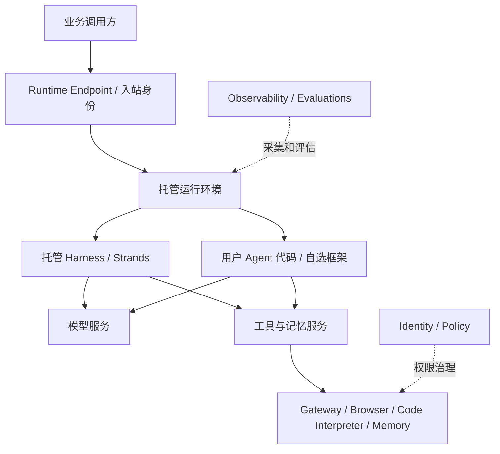

# Amazon AgentCore 架构职责与七维模型

## “七层”实际上对应两种不同表述

AWS 2025 年推出的七项模块化服务为 Runtime、Memory、Gateway、Identity、Browser、Code Interpreter、Observability。它们可组合使用，不是必须逐层调用的纵向七层栈。[B5]

AWS 2025-09-30 的韧性架构文章定义另一套七维模型：[B6]

| 官方分析维度 | 关注职责 | 与 AgentCore 的关系（研究映射） |
|---|---|---|
| Foundation models | 推理与生成 | 模型服务是依赖，Runtime 不限定单一模型 |
| Agent orchestration | 循环、路由、人工升级 | Harness 或自带编排代码 |
| Deployment infrastructure | 执行和资源生命周期 | Runtime |
| Knowledge base | 摄取、嵌入、检索 | 外部知识库；不能等同 Memory |
| Agent tools | 外部动作与上下文能力 | Gateway、Browser、Code Interpreter、Memory 等 |
| Security and compliance | 身份、权限与内容控制 | Identity、Policy 和外围控制 |
| Evaluation and observability | 质量和运行行为分析 | Observability、Evaluations 等 |

这是分析完整系统的维度，不是 AgentCore 独占的内部部署拓扑。安全与观测横跨其他维度。当前服务概览已扩展，包含 Harness、Policy、Registry、Evaluations、Optimization、Payments 等；用初始七项作为当前完整清单会遗漏能力。[B1]

## 执行关系

下图为根据公开职责重构的研究视图，不表示 AWS 内部微服务结构。

Runtime 提供 microVM 和 Instances 两种计算方式；专属 microVM 的会话隔离表述不能无条件推广到共享实例模式。Instances 支持长时会话、GPU 与多 Agent 协作，资源和隔离评估须按模式重新开展。[B3]

[来源](sources.md) · [产品概览](README.md)

## Knowledge Extraction

来源与机制用于支撑本产品调研；可复用流程已归入产品调研技能，本页不独立生成原子知识。
