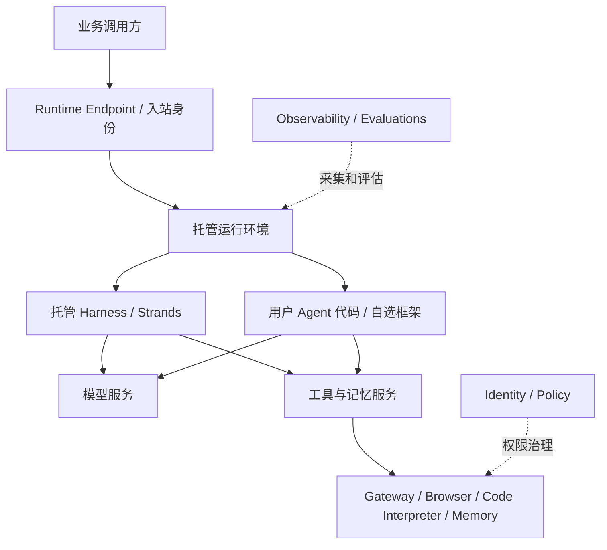

# Amazon Bedrock AgentCore 详细调研

证据基线为 2026-10-10；2026-10-12 调整阅读结构并补充定位与架构分析。未新增部署实验。本次复核 B2 Harness 与 Runtime 关系，其他来源沿用原查阅日期。

[先读摘要](summary.md) · [产品索引](../README.md)

## 阅读路线

从定位与边界开始，继而理解软件组件、典型执行路径和设计取舍；定制、托管与费用用于解释架构的实际边界。图和调用解释是公开资料的研究视图，源码证据只覆盖注明的组件，不推定未公开的内部拓扑。

## 产品定位与边界

### 面向谁，核心侧重点是什么

官方将 AgentCore 定义为 Agent 构建、部署和运行平台。[B1](https://docs.aws.amazon.com/bedrock-agentcore/latest/devguide/what-is-bedrock-agentcore.html) **研究判断：**主要使用者是已有 Agent 软件的开发者、需要共享运行能力的企业平台团队，以及希望采用托管循环的应用作者。它的核心软件问题是把 Agent Loop 与运行、工具、身份和记忆等基础服务衔接起来。

其产品组织围绕可组合服务展开：Runtime 承载执行，Harness 减少循环开发，其他原语按需接入。对使用者而言，先选“自带执行逻辑还是采用托管循环”，再决定哪些平台服务参与，通常比先背诵服务清单更有帮助。

### 结论与研究范围

查阅日期：2026-10-10。依据官方滚动文档和示例仓库，未部署服务或测试生产指标。

AgentCore 是可组合的 Agent 构建与运行平台。Runtime 提供托管执行环境，当前 Harness 则在 Runtime 上提供由 Strands 驱动的托管执行循环。Runtime 的框架中立性不能套用到 Harness 的编排引擎选择上。[B1](https://docs.aws.amazon.com/bedrock-agentcore/latest/devguide/what-is-bedrock-agentcore.html)[B2](https://docs.aws.amazon.com/bedrock-agentcore/latest/devguide/harness-vs-runtime.html)

用户提供的 `awslabs/agentcore-samples` 是集成示例仓库，不是 AgentCore 云平台完整源码；样例的开源许可也不意味着可以自行部署相同的 AWS 控制面。[B4](https://github.com/awslabs/agentcore-samples)

### 与阿里云的主要区别

两者均应按托管执行循环和自带代码分别比较。AWS 更突出可独立采用的服务原语；阿里云文档更突出 Workspace 中的资源组织与 Agent／Team 管理。这是对公开产品界面的分析，不能推导底层实现谁更先进。

当前 AWS Harness 文档列出配置式 Memory、Gateway、Browser 和 Code Interpreter 集成；阿里云托管 Harness 当前支持清单中的长期记忆等限制应单独记录。不能沿用早期“阿里低代码、AWS 只有代码部署”的结论。[B2](https://docs.aws.amazon.com/bedrock-agentcore/latest/devguide/harness-vs-runtime.html) 对照 [阿里云模式边界](../alibaba-agentcore/detail.md#定制与运行边界)。

## 软件架构

### “七层”实际上对应两种不同表述

AWS 2025 年推出的七项模块化服务为 Runtime、Memory、Gateway、Identity、Browser、Code Interpreter、Observability。它们可组合使用，不是必须逐层调用的纵向七层栈。[B5](https://aws.amazon.com/blogs/compute/serverless-icymi-q3-2025/)

AWS 2025-09-30 的韧性架构文章定义另一套七维模型：[B6](https://aws.amazon.com/blogs/architecture/build-resilient-generative-ai-agents/)

| 官方分析维度 | 关注职责 | 与 AgentCore 的关系（研究映射） |
|---|---|---|
| Foundation models | 推理与生成 | 模型服务是依赖，Runtime 不限定单一模型 |
| Agent orchestration | 循环、路由、人工升级 | Harness 或自带编排代码 |
| Deployment infrastructure | 执行和资源生命周期 | Runtime |
| Knowledge base | 摄取、嵌入、检索 | 外部知识库；不能等同 Memory |
| Agent tools | 外部动作与上下文能力 | Gateway、Browser、Code Interpreter、Memory 等 |
| Security and compliance | 身份、权限与内容控制 | Identity、Policy 和外围控制 |
| Evaluation and observability | 质量和运行行为分析 | Observability、Evaluations 等 |

这是分析完整系统的维度，不是 AgentCore 独占的内部部署拓扑。安全与观测横跨其他维度。当前服务概览已扩展，包含 Harness、Policy、Registry、Evaluations、Optimization、Payments 等；用初始七项作为当前完整清单会遗漏能力。[B1](https://docs.aws.amazon.com/bedrock-agentcore/latest/devguide/what-is-bedrock-agentcore.html)

### 执行关系

下图为根据公开职责重构的研究视图，不表示 AWS 内部微服务结构。

Runtime 提供 microVM 和 Instances 两种计算方式；专属 microVM 的会话隔离表述不能无条件推广到共享实例模式。Instances 支持长时会话、GPU 与多 Agent 协作，资源和隔离评估须按模式重新开展。[B3](https://docs.aws.amazon.com/bedrock-agentcore/latest/devguide/agents-tools-runtime.html)

## 一次请求如何执行

以下以 Runtime 上的一次 Agent 调用解释公开职责，服务选择随应用而变化。[B1](https://docs.aws.amazon.com/bedrock-agentcore/latest/devguide/what-is-bedrock-agentcore.html)[B2](https://docs.aws.amazon.com/bedrock-agentcore/latest/devguide/harness-vs-runtime.html)[B3](https://docs.aws.amazon.com/bedrock-agentcore/latest/devguide/agents-tools-runtime.html)

1. 用户发布自带代码，或定义托管 Harness 的模型、指令和工具；运行入口关联 Agent 版本与配置。
2. 调用方访问 Runtime Endpoint，经入站身份校验后进入对应运行环境和会话。
3. Harness 的 Strands 循环或用户应用调用模型。需要工具时，执行逻辑按配置／代码调用 Gateway、Browser、Code Interpreter 等服务，不要求调用全部模块。
4. Memory、文件系统和应用自行维护的执行状态承担不同数据职责；观测记录用于分析调用行为。
5. 执行结果经入口返回。运行环境的停止／恢复与业务外部动作是否重复，是不同问题。

与应用代码部署分开，配置、版本与 Endpoint 属于控制职责，运行环境、会话和工具动作属于执行职责；这是研究上的划分，不说明 AWS 内部控制面采用何种微服务实现。

## 架构如何支撑产品定位

**研究判断：**平台原语与 Agent Loop 分开，使相同运行基础能够承载不同框架，并允许用户逐步接入记忆、工具与治理。Harness 在其上提供更少代码的路径。这解释了产品为什么同时保留框架中立 Runtime 和固定托管循环。

这种组合并未消除应用集成责任：用户需要决定记忆的作用域、工具凭据、调用失败后的重试与补偿。平台服务各自可靠，也不能推出它们与业务系统具有联合事务。

已确认的实现机制包括托管 Harness 的 Strands、Runtime 的计算模式及服务契约；云平台内部拓扑未由样例仓库公开。[B2](https://docs.aws.amazon.com/bedrock-agentcore/latest/devguide/harness-vs-runtime.html)[B3](https://docs.aws.amazon.com/bedrock-agentcore/latest/devguide/agents-tools-runtime.html)[B4](https://github.com/awslabs/agentcore-samples) 架构比较应关注职责组合与状态边界，而非用初始模块数量判断完整性。

## 定制与运行边界

### 两种定制入口

| 入口 | 用户提供 | 托管边界 |
|---|---|---|
| Harness | 模型、指令、工具、技能、记忆和执行限制配置；需要时提供依赖镜像 | 平台运行 Strands 循环；不提供任意替换编排框架的同等配置项 |
| Runtime | 应用代码、执行逻辑及服务适配 | 平台托管进程，应用自行调用其他原语并维护编排 |

配置式定制降低运行循环和基础集成的代码量；并不自动替企业实现业务审批、工具正确性和异常补偿。自带容器亦需要用户维护依赖。[B2](https://docs.aws.amazon.com/bedrock-agentcore/latest/devguide/harness-vs-runtime.html)[B7](https://docs.aws.amazon.com/bedrock-agentcore/latest/devguide/harness.html)

### 企业托管责任

企业能力的价值在于把开发者的执行逻辑接入身份、运行生命周期与治理，不能只用“能上传代码”判断。

| 职责 | 平台提供的入口 | 用户仍需确认 |
|---|---|---|
| 运行 | 隔离、伸缩与计算模式 | 业务并发、配额与模型限流 |
| 身份 | 入站 IAM／OAuth，出站凭据机制 | 用户与工具权限映射、撤销策略 |
| 网络 | VPC 接入能力 | 端点连通、出站范围与依赖服务 |
| 发布 | 版本和 Endpoint | 配置兼容性、已有会话、回滚策略 |
| 观测 | 运行遥测及 Agent 集成 | 自定义工具埋点、敏感数据处理 |
| 状态 | 文件系统持久化；可配置 Memory | 编排检查点与外部事务不自动由文件或记忆代替 |

按官方说明 microVM 与 Instances 的会话上限分别可达 8 小时和 14 天；这是模式限制，不能当作无限运行或业务 SLA。[B3](https://docs.aws.amazon.com/bedrock-agentcore/latest/devguide/agents-tools-runtime.html) 服务能力需进一步核对区域、配额与合同。

费用分解应包含使用的 AgentCore 服务、模型、存储、网络及其他 AWS 依赖。当前没有实际账单，不能据按量计费断言其更便宜。[B8](https://aws.amazon.com/bedrock/agentcore/pricing/)

## 待验证事项

| 问题 | 实测触发与观察 |
|---|---|
| 隔离 | 双用户恶意交叉访问，分别测试 microVM 与 Instances 设计 |
| 恢复 | 停止／恢复会话，检查文件、循环状态、已执行工具结果 |
| 权限 | 撤销凭据后重复调用，检查缓存、拒绝与审计 |
| 成本 | 固定业务任务，分别统计执行、模型、存储、网关与观测账单 |
| 发布 | 新版本流量切换后检查已有会话行为和回滚 |

## 参考来源

查阅日期：2026-10-10。云文档滚动更新，历史博客只用于解释原始定义。本次未走读云平台实现源码，样例仅用于判断仓库性质。

| 编号 | 官方来源 | 支持范围 |
|---|---|---|
| B1 | [Overview](https://docs.aws.amazon.com/bedrock-agentcore/latest/devguide/what-is-bedrock-agentcore.html) | 定义、当前模块清单 |
| B2 | [Harness vs Runtime](https://docs.aws.amazon.com/bedrock-agentcore/latest/devguide/harness-vs-runtime.html) | Strands、配置与代码责任 |
| B3 | [Runtime](https://docs.aws.amazon.com/bedrock-agentcore/latest/devguide/agents-tools-runtime.html) | 计算类型、隔离、运行时限 |
| B4 | [agentcore-samples](https://github.com/awslabs/agentcore-samples) | 示例仓库与许可 |
| B5 | [Serverless ICYMI Q3 2025](https://aws.amazon.com/blogs/compute/serverless-icymi-q3-2025/) | 初始七项服务历史 |
| B6 | [Build resilient generative AI agents](https://aws.amazon.com/blogs/architecture/build-resilient-generative-ai-agents/) | 2025-09-30 七维风险架构 |
| B7 | [Harness](https://docs.aws.amazon.com/bedrock-agentcore/latest/devguide/harness.html) | 托管循环与配置入口 |
| B8 | [Pricing](https://aws.amazon.com/bedrock/agentcore/pricing/) | 计费维度 |

## Knowledge Extraction

- [x] 将历史服务清单、架构分析维度和当前能力分开，纳入调研技能。
- [ ] 生产恢复和隔离结论需要部署实验。
- [x] 2026-10-12 将报告重心调整为产品定位与软件架构，定制和托管作为辅助解释。

[返回摘要](summary.md)
