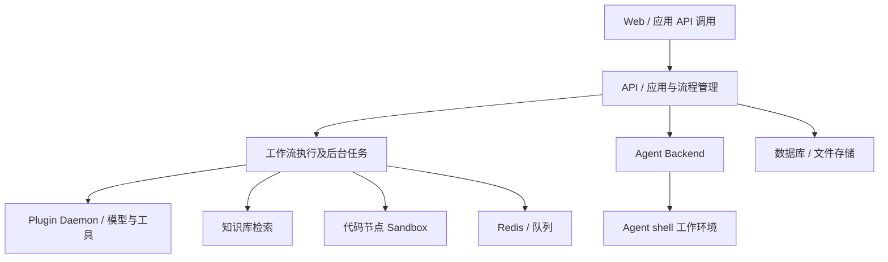

# Dify 架构与执行子系统

## 公开结构与研究映射

当前部署清单包含 web、api、worker、worker_beat、plugin_daemon、数据库、Redis、向量存储选项，以及 agent_backend 与 local_sandbox。普通代码节点的 sandbox 和新 Agent shell 的 local_sandbox 是不同服务，不能只写一个笼统的“沙箱层”。[D3]

下图为部署清单和产品能力的研究映射，不是全量内部调用图。

## Agent 相关的三种含义

1. 平台整体包含 Agent 应用能力。
2. 2025 年 Agent Node 在流程内通过 Agent Strategy 插件组织模型和工具决策；历史文章说明了这个扩展设计。[D4]
3. 当前新的 Agent 子系统支持 CLI 任务与 Build Mode。仓库文档说明 FastAPI 服务承载 Agenton 组合的 Pydantic AI runs；Go runtime 的 shellctl 管理执行作业。[D5][D6][D7]

Agenton 的图配置、逐次调用配置和可序列化运行状态分开；存活的客户端、文件句柄与进程资源不由其核心快照保存。因而“有 snapshot”不能推断任意进程能恢复原执行位置。[D8]

## 隔离边界

Go runtime 文档说明 Landlock 文件访问限制，并指出内核支持条件。Compose 清单还注明 local sandbox 与 backend 的网络通道存在已知限制。[D3][D7] 官方新 Agent 文章描述 Enterprise 的每会话专用容器及网络策略；这项 Enterprise 描述不能直接充当 Community 默认部署的隔离保证。[D5]

[来源](sources.md) · [产品概览](README.md)

## Knowledge Extraction

来源与机制用于支撑本产品调研；可复用流程已归入产品调研技能，本页不独立生成原子知识。
