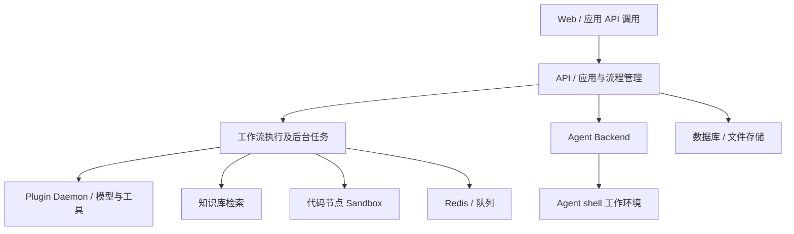

# Dify 详细调研

证据基线为 2026-10-10；2026-10-12 调整阅读结构并补充定位与架构分析。未新增部署实验。本次复核固定提交下 D6 的 Agent 技术文档，其余基线未变。

[先读摘要](summary.md) · [产品索引](../README.md)

## 阅读路线

从定位与边界开始，继而理解软件组件、典型执行路径和设计取舍；定制、托管与费用用于解释架构的实际边界。图和调用解释是公开资料的研究视图，源码证据只覆盖注明的组件，不推定未公开的内部拓扑。

## 产品定位与边界

### 面向谁，核心侧重点是什么

官方定位为 LLM 应用开发平台。[D1](https://github.com/langgenius/dify/blob/0afbe55884d62cb492e4cdbbf470954f252fb474/README.md) **研究判断：**主要使用者是应用作者、业务流程设计者、插件开发者和运营团队。其核心软件问题是把模型、数据和动作组织为可编辑、可发布、可重复执行的业务应用。

所以需要从应用／流程定义理解产品，而不只研究一次模型请求。Workflow 说明任务何时执行、前后步骤怎样连接；Agent 在任务内部选择动作；插件和知识处理提供复用能力。这也解释了为什么 Dify 会同时出现业务流程和自主执行两种结构。

### 结论与范围

查阅日期：2026-10-10。研究官方产品说明、部署清单及仓库内技术文档，未部署。源码基线为 `0afbe55884d62cb492e4cdbbf470954f252fb474`，由 main 分支远程引用查询取得，不等同于所有云端实例版本。

Dify 是 LLM 应用开发平台，围绕可视化工作流、知识处理、模型与工具集成组织应用。[D1](https://github.com/langgenius/dify/blob/0afbe55884d62cb492e4cdbbf470954f252fb474/README.md) 当前调研必须包含新的 Dify Agent：2026-08-27 官方说明其支持对话构建、技能与 CLI 工作环境，不应只依据 2025 年 Agent Node 的介绍描述现状。[D4](https://dify.ai/blog/dify-agent-node-introduction-when-workflows-learn-autonomous-reasoning)[D5](https://dify.ai/blog/why-we-redesigned-dify-agent)

最值得借鉴的设计是把业务流程与自主任务分开：Workflow 约束步骤之间的顺序和边界，Agent 在某一步内部选择动作。这种组合比“一个提示词就是整个应用”提供更明确的可维护结构。

### 核心能力与入口

| 面向对象 | 定制方式 | 责任 |
|---|---|---|
| 应用作者 | 可视化图、模型、提示词、知识检索、工具 | 业务输入输出和流程边界 |
| Agent 作者 | 新 Agent 的 Build Mode、指令、技能、工具 | 任务目标、执行权限和验收 |
| 插件开发者 | 工具、模型或 Agent Strategy 扩展 | 新能力的代码和契约 |
| 平台运营者 | Cloud、Community 或 Enterprise 部署选择 | 版本、容量、租户与治理 |

公开仓库当前 Dify Agent 技术文档指向 Agenton 组合的 Pydantic AI 执行与 FastAPI 服务；这是该子系统依据，不能概括成“整个 Dify 基于 Pydantic AI”。[D6](https://github.com/langgenius/dify/blob/0afbe55884d62cb492e4cdbbf470954f252fb474/dify-agent/docs/dify-agent/index.md)

## 软件架构

### 公开结构与研究映射

当前部署清单包含 web、api、worker、worker_beat、plugin_daemon、数据库、Redis、向量存储选项，以及 agent_backend 与 local_sandbox。普通代码节点的 sandbox 和新 Agent shell 的 local_sandbox 是不同服务，不能只写一个笼统的“沙箱层”。[D3](https://github.com/langgenius/dify/blob/0afbe55884d62cb492e4cdbbf470954f252fb474/docker/docker-compose.yaml)

下图为部署清单和产品能力的研究映射，不是全量内部调用图。

### Agent 相关的三种含义

1. 平台整体包含 Agent 应用能力。
2. 2025 年 Agent Node 在流程内通过 Agent Strategy 插件组织模型和工具决策；历史文章说明了这个扩展设计。[D4](https://dify.ai/blog/dify-agent-node-introduction-when-workflows-learn-autonomous-reasoning)
3. 当前新的 Agent 子系统支持 CLI 任务与 Build Mode。仓库文档说明 FastAPI 服务承载 Agenton 组合的 Pydantic AI runs；Go runtime 的 shellctl 管理执行作业。[D5](https://dify.ai/blog/why-we-redesigned-dify-agent)[D6](https://github.com/langgenius/dify/blob/0afbe55884d62cb492e4cdbbf470954f252fb474/dify-agent/docs/dify-agent/index.md)[D7](https://github.com/langgenius/dify/blob/0afbe55884d62cb492e4cdbbf470954f252fb474/dify-agent-runtime/README.md)

Agenton 的图配置、逐次调用配置和可序列化运行状态分开；存活的客户端、文件句柄与进程资源不由其核心快照保存。因而“有 snapshot”不能推断任意进程能恢复原执行位置。[D8](https://github.com/langgenius/dify/blob/0afbe55884d62cb492e4cdbbf470954f252fb474/dify-agent/docs/agenton/guide/index.md)

### 隔离边界

Go runtime 文档说明 Landlock 文件访问限制，并指出内核支持条件。Compose 清单还注明 local sandbox 与 backend 的网络通道存在已知限制。[D3](https://github.com/langgenius/dify/blob/0afbe55884d62cb492e4cdbbf470954f252fb474/docker/docker-compose.yaml)[D7](https://github.com/langgenius/dify/blob/0afbe55884d62cb492e4cdbbf470954f252fb474/dify-agent-runtime/README.md) 官方新 Agent 文章描述 Enterprise 的每会话专用容器及网络策略；这项 Enterprise 描述不能直接充当 Community 默认部署的隔离保证。[D5](https://dify.ai/blog/why-we-redesigned-dify-agent)

## 一次请求如何执行

下列路径是依据产品文档和部署清单组织的逻辑说明；未逐个函数追踪，所以不把它当作精确进程调用图。[D1](https://github.com/langgenius/dify/blob/0afbe55884d62cb492e4cdbbf470954f252fb474/README.md)[D3](https://github.com/langgenius/dify/blob/0afbe55884d62cb492e4cdbbf470954f252fb474/docker/docker-compose.yaml)[D4](https://dify.ai/blog/dify-agent-node-introduction-when-workflows-learn-autonomous-reasoning)[D6](https://github.com/langgenius/dify/blob/0afbe55884d62cb492e4cdbbf470954f252fb474/dify-agent/docs/dify-agent/index.md)

1. 应用作者在 Web 界面定义流程和资源，发布后业务调用方通过应用入口提交输入。
2. 执行逻辑按图选择下一节点。模型节点、知识检索和工具节点承担不同职责；后台任务由相应工作进程处理，不应理解为所有请求都必经 worker。
3. Agent Node 可通过策略扩展在局部任务内组织模型和工具循环；新 Agent 子系统则由 Agent Backend 承载执行，并在需要命令／文件操作时使用 shell 工作环境。这两者不应合并为同一个实现路径。
4. 节点结果成为后续流程输入，直到形成应用输出。配置、对话、知识索引、上传文件与工作目录属于不同状态对象。

从架构角色看，应用配置与发布是控制职责，流程和 Agent 执行是运行职责；API 进程可能承担多个角色，不能仅凭角色划分推断它们已经物理分离。

## 架构如何支撑产品定位

**研究判断：**Dify 的应用定位解释了为什么编排画布、插件和知识处理处于重要位置：使用者希望把流程连接起来，而不只是启动一个 Agent 进程。把自主任务放入有边界的流程，可同时保留业务结构和模型选择动作的灵活性。

这种设计的代价在于执行语义分散：工作流状态、策略循环、Agenton 快照、shell 作业和外部工具结果并非一种状态。平台需要协调发布、日志与恢复，用户也需要理解业务边界。

已确认的基础包括 Compose 服务结构、新 Agent 的 FastAPI／Pydantic AI／Agenton 关系以及 Go runtime。[D3](https://github.com/langgenius/dify/blob/0afbe55884d62cb492e4cdbbf470954f252fb474/docker/docker-compose.yaml)[D6](https://github.com/langgenius/dify/blob/0afbe55884d62cb492e4cdbbf470954f252fb474/dify-agent/docs/dify-agent/index.md)[D7](https://github.com/langgenius/dify/blob/0afbe55884d62cb492e4cdbbf470954f252fb474/dify-agent-runtime/README.md)[D8](https://github.com/langgenius/dify/blob/0afbe55884d62cb492e4cdbbf470954f252fb474/dify-agent/docs/agenton/guide/index.md) 本次没有完整走读 Workflow 引擎和数据库 schema，因此不推定其调度算法、全部 API 路由或一致性协议。

## 定制与运行边界

### 低代码能力的定位

可视化 Workflow 让作者显式组合模型、检索和工具；Agent Node 的策略扩展把自主决策放在局部步骤；新的 Build Mode 进一步允许通过对话积累配置与技能。[D1](https://github.com/langgenius/dify/blob/0afbe55884d62cb492e4cdbbf470954f252fb474/README.md)[D4](https://dify.ai/blog/dify-agent-node-introduction-when-workflows-learn-autonomous-reasoning)[D5](https://dify.ai/blog/why-we-redesigned-dify-agent) 三者属于不同定制粒度，不应把生成技能、拖拽节点与框架编程统称为同一种低代码。

研究判断：Dify 对流程作者更直接，而 AgentCore 更强调托管与服务接入。两者有重叠，但不能依据界面体验判断生产韧性或性能领先。

### 部署责任矩阵

| 模式 | 谁运营 | 需要单独核对 |
|---|---|---|
| Cloud | 服务商运营平台 | 套餐、数据位置、额度及合同 |
| Community 自部署 | 用户运营全部组件 | 数据备份、扩缩容、镜像升级、插件权限、网络 |
| Enterprise 私有部署 | 按购买和交付约定 | SSO、RBAC、隔离策略、支持范围与 SLA |

官方列出 Enterprise 的 SSO、RBAC 与支持能力。[D1](https://github.com/langgenius/dify/blob/0afbe55884d62cb492e4cdbbf470954f252fb474/README.md)[D9](https://dify.ai/dify-enterprise) “可以 Docker Compose 启动”只证明部署入口存在，不能证明具有自动容灾和生产 SLA。

### 数据与恢复

应用配置、对话、上传文件、知识索引和 Agent 工作目录需要分别纳入备份策略。runtime 的 Home snapshot 文档明确表示 restore 不是事务，途中失败应重建环境；它也不是业务流程与外部系统的联合事务。[D7](https://github.com/langgenius/dify/blob/0afbe55884d62cb492e4cdbbf470954f252fb474/dify-agent-runtime/README.md)

队列重试是否重新调用已完成工具、审批能否跨重启恢复、租户数据是否越权，都需要运行级验证。源码中有持久化与隔离组件不代表这些组合属性自动成立。

### 许可边界

仓库标注 Dify Open Source License，以 Apache 2.0 为基础附加条件；许可文件另列多租户服务和前端标识相关条款。[D2](https://github.com/langgenius/dify/blob/0afbe55884d62cb492e4cdbbf470954f252fb474/LICENSE) 选型记录应引用原文并核对计划用途，不能只标“Apache-2.0”。此处记录条款存在，不替具体商业用途作法律判断。

## 待验证事项

用同一个审批加检索任务分别验证 Workflow、Agent Node 与新 Agent 的流程导出、异常重试和日志关联。自部署时测试断电恢复、插件故障、并发和不同用户的文件访问。Enterprise 的隔离与权限需要对应版本和合同验证。

## 参考来源

查阅日期：2026-10-10。源码基线 `0afbe55884d62cb492e4cdbbf470954f252fb474`。技术文档／Compose 阅读不是完整安全审计，未运行产品。

| 编号 | 官方来源 | 支持范围 |
|---|---|---|
| D1 | [README](https://github.com/langgenius/dify/blob/0afbe55884d62cb492e4cdbbf470954f252fb474/README.md) | 定义、产品能力与部署版本 |
| D2 | [LICENSE](https://github.com/langgenius/dify/blob/0afbe55884d62cb492e4cdbbf470954f252fb474/LICENSE) | 附加许可条件 |
| D3 | [Compose](https://github.com/langgenius/dify/blob/0afbe55884d62cb492e4cdbbf470954f252fb474/docker/docker-compose.yaml) | 服务与网络结构 |
| D4 | [Agent Node introduction](https://dify.ai/blog/dify-agent-node-introduction-when-workflows-learn-autonomous-reasoning) | 2025-03-12 策略插件设计 |
| D5 | [Why We Redesigned Dify's Agent](https://dify.ai/blog/why-we-redesigned-dify-agent) | 2026-08-27 新 Agent 与 Enterprise 描述 |
| D6 | [Agent runtime index](https://github.com/langgenius/dify/blob/0afbe55884d62cb492e4cdbbf470954f252fb474/dify-agent/docs/dify-agent/index.md) | Agenton / Pydantic AI / FastAPI |
| D7 | [Go runtime README](https://github.com/langgenius/dify/blob/0afbe55884d62cb492e4cdbbf470954f252fb474/dify-agent-runtime/README.md) | shellctl、隔离与 Home snapshot |
| D8 | [Agenton guide](https://github.com/langgenius/dify/blob/0afbe55884d62cb492e4cdbbf470954f252fb474/dify-agent/docs/agenton/guide/index.md) | 配置、状态、资源责任 |
| D9 | [Enterprise](https://dify.ai/dify-enterprise) | 商业版本能力说明 |

## Knowledge Extraction

- [x] 将社区、Cloud、Enterprise 的能力及运维责任区分纳入技能。
- [x] 将历史介绍与当前新增子系统的交叉核验纳入技能。
- [ ] 流程恢复、权限与隔离待实测。
- [x] 2026-10-12 将报告重心调整为产品定位与软件架构，定制和托管作为辅助解释。

[返回摘要](summary.md)
