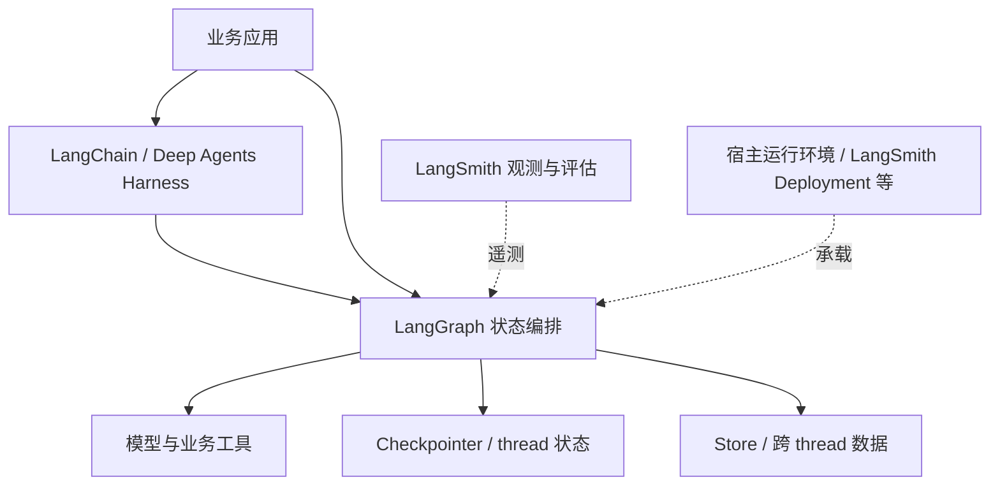

# LangChain 生态架构职责

## 组件边界

| 组件 | 公开定位 | 平台设计关注点 |
|---|---|---|
| LangChain | 模型、工具、middleware 组成 Harness | 快速组合 Agent 循环 |
| LangGraph | 状态编排与运行库 | 自定义图、人工交互、持久化 |
| Deep Agents | 更完整的 Harness | 规划、子 Agent、文件系统与上下文管理 |
| LangSmith | 观测、评估、提示词与部署平台 | 运行治理及交付 |
| Fleet | 无代码 Agent 构建产品 | 模板、服务连接、审批及自动化 |

依据 [L1][L2][L6][L7]。不是垂直必选依赖：LangGraph 不要求使用 LangChain，LangSmith 亦支持跨框架接入。

下图仅表示典型职责关系，图中的观测连接不意味着应用必须部署在 LangSmith。

## 状态层次

Checkpointer 保存 thread 范围内的图状态，Store 保存应用定义的跨 thread 数据。二者不能等同文件系统，也不承担外部数据库动作的联合事务。[L3]

`InMemorySaver` 的示例只保存 RAM 状态，进程重启后会丢失；生产恢复需要持久化后端及其运维。Agent Server 文档描述了服务端管理持久化的路径，不应把它的责任套到纯本地库模式。[L3][L5]

## Knowledge Extraction

- [x] 生态组件与状态责任已纳入产品调研技能。

[来源](sources.md) · [产品概览](README.md)
