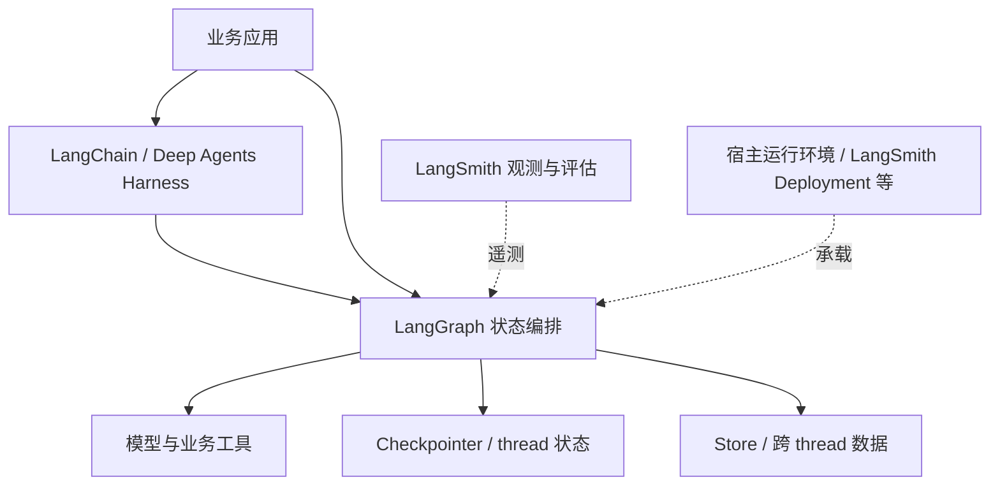

# LangChain 详细调研

证据基线为 2026-10-10；2026-10-12 调整阅读结构并补充定位与架构分析。未新增部署实验。本次复核 L1 overview，其余来源沿用原查阅日期。

[先读摘要](summary.md) · [产品索引](../README.md)

## 阅读路线

从定位与边界开始，继而理解软件组件、典型执行路径和设计取舍；定制、托管与费用用于解释架构的实际边界。图和调用解释是公开资料的研究视图，源码证据只覆盖注明的组件，不推定未公开的内部拓扑。

## 产品定位与边界

### 面向谁，核心侧重点是什么

LangChain 官方入口强调可配置 Harness，LangGraph 强调较低层状态编排。[L1](https://docs.langchain.com/oss/python/langchain/overview)[L2](https://docs.langchain.com/oss/python/langgraph/overview) **研究判断：**主要使用者是需要用代码表达 Agent 行为的应用开发者。核心软件问题是把模型、工具与上下文组成循环，并在复杂流程中显式表达状态、路由和暂停。

对框架使用者，先判断预制循环是否足够，还是需要自定义状态图；对平台团队，再判断如何托管和观测这些程序。LangSmith、Fleet 和 Deep Agents 分别覆盖关联需求，不能用它们的能力改写纯 LangChain 包的定位。

### 范围与结论

查阅日期：2026-10-10。研究当前 Python 官方文档和关联商业平台，不安装 SDK、不测试部署，也不把本次结论推广到所有 JS 版本。文档滚动更新，本次没有绑定源码提交。

LangChain 当前提供 `create_agent`，通过模型、工具、提示词和 middleware 组合可定制 Harness，Agent 底层建立在 LangGraph 上。[L1](https://docs.langchain.com/oss/python/langchain/overview) LangGraph 是较低层的状态编排框架／运行库，适合将确定性步骤和模型决策组合。[L2](https://docs.langchain.com/oss/python/langgraph/overview)

LangSmith 是相关平台，负责观测、评估及部署。它的商业托管能力不能写成安装 LangChain 包后默认获得的能力。[L5](https://docs.langchain.com/langsmith/deployment) Deep Agents 提供更完整的 Harness，Fleet 提供无代码构建；它们应作为关联产品分别辨认，而不是叫作 LangChain 的几个内置开关。[L6](https://docs.langchain.com/oss/python/deepagents/overview)[L7](https://docs.langchain.com/langsmith/fleet)

### 与本系列其他产品的关系

LangChain／LangGraph 可作为 AgentCore Runtime 中应用的执行逻辑，二者关注的职责能够组合。LangSmith Deployment 则在托管运行方面形成另一种平台选择。比较时分别比较 Harness、编排、治理与部署，不能把整个生态与单个框架包作排行榜。

## 软件架构

### 组件边界

| 组件 | 公开定位 | 平台设计关注点 |
|---|---|---|
| LangChain | 模型、工具、middleware 组成 Harness | 快速组合 Agent 循环 |
| LangGraph | 状态编排与运行库 | 自定义图、人工交互、持久化 |
| Deep Agents | 更完整的 Harness | 规划、子 Agent、文件系统与上下文管理 |
| LangSmith | 观测、评估、提示词与部署平台 | 运行治理及交付 |
| Fleet | 无代码 Agent 构建产品 | 模板、服务连接、审批及自动化 |

依据 [L1](https://docs.langchain.com/oss/python/langchain/overview)[L2](https://docs.langchain.com/oss/python/langgraph/overview)[L6](https://docs.langchain.com/oss/python/deepagents/overview)[L7](https://docs.langchain.com/langsmith/fleet)。不是垂直必选依赖：LangGraph 不要求使用 LangChain，LangSmith 亦支持跨框架接入。

下图仅表示典型职责关系，图中的观测连接不意味着应用必须部署在 LangSmith。

### 状态层次

Checkpointer 保存 thread 范围内的图状态，Store 保存应用定义的跨 thread 数据。二者不能等同文件系统，也不承担外部数据库动作的联合事务。[L3](https://docs.langchain.com/oss/python/langgraph/persistence)

`InMemorySaver` 的示例只保存 RAM 状态，进程重启后会丢失；生产恢复需要持久化后端及其运维。Agent Server 文档描述了服务端管理持久化的路径，不应把它的责任套到纯本地库模式。[L3](https://docs.langchain.com/oss/python/langgraph/persistence)[L5](https://docs.langchain.com/langsmith/deployment)

## 一次请求如何执行

以下解释 Python 文档中的典型调用关系，不代表所有生态产品采用同一部署。[L1](https://docs.langchain.com/oss/python/langchain/overview)[L2](https://docs.langchain.com/oss/python/langgraph/overview)[L3](https://docs.langchain.com/oss/python/langgraph/persistence)[L4](https://docs.langchain.com/oss/python/langgraph/interrupts)

1. 应用通过 create_agent 组合模型、工具和 middleware，或直接定义 LangGraph 状态与节点。
2. 输入进入 Harness／图；执行逻辑调用模型或确定性业务代码，按结果决定下一步。
3. 工具结果和节点输出更新状态。需要连续交互／恢复时，checkpointer 按 thread 保存图状态；跨 thread 的应用数据由 Store 管理。
4. 遇到 interrupt 时，执行等待外部输入。宿主使用同一 thread 标识提供恢复值；恢复节点会从头执行，因此 interrupt 前的动作可能重跑。
5. 最终输出交给业务应用。应用可以独立运行，也可以由 Agent Server／LangSmith Deployment 等宿主承载；观测接入是另外一个选择。

开发时的图与节点定义、部署配置属于控制职责，实际 runs 和持久化状态属于执行职责。纯库模式没有天然的独立控制服务，不能直接套用 SaaS 控制面架构。

## 架构如何支撑产品定位

**研究判断：**LangChain 的组合式 Harness 支持快速构建，而 LangGraph 把更复杂的流程控制暴露给开发者。这种上下层关系允许先使用循环，再在有需要的地方显式安排确定性步骤、暂停和状态保存。

代价是恢复语义成为应用设计的一部分：使用者要选择持久化后端，决定节点粒度，并处理外部效果的重复执行。图状态可恢复不表示进程堆栈或外部数据库事务被自动恢复。

LangSmith Deployment 把应用发布和运行运营提升为服务，Fleet 则面向无代码构建。[L5](https://docs.langchain.com/langsmith/deployment)[L7](https://docs.langchain.com/langsmith/fleet) 这说明代码框架、托管平台和无代码产品分别覆盖不同用户需求；它们的关联不能解释为所有组件都必须采用。

## 定制与运行边界

### 定制能力

`create_agent` 面向代码作者，通过 middleware 改变模型调用、工具策略和上下文；LangGraph 提供更细的节点、路由与状态设计。[L1](https://docs.langchain.com/oss/python/langchain/overview)[L2](https://docs.langchain.com/oss/python/langgraph/overview) 接口简短不等于可视化低代码。Fleet 才是生态中明确面向无代码构建的产品，原 Agent Builder 已更名为 Fleet。[L7](https://docs.langchain.com/langsmith/fleet)

因此调研“LangChain 是否支持低代码”时，需要分别回答框架代码入口与 Fleet 产品入口；还需确认可迁移配置、支持工具与套餐，不能推定两者具有完全同构的定制能力。

### 企业托管责任

官方 LangSmith Deployment 支持以下部署环境：[L5](https://docs.langchain.com/langsmith/deployment)

| 环境 | 控制面 | 数据面及运维 |
|---|---|---|
| Cloud | 服务商 | 服务商承载 Agent Server 与数据库 |
| Hybrid | 服务商 | 用户基础设施承载数据面 |
| Self-hosted with control plane | 用户 | 用户 Kubernetes；需要对应 Enterprise 授权 |
| Standalone server | 无部署控制面 | 用户运营 Server、PostgreSQL、Redis 等并核对许可 |

观测平台放在哪里与执行部署放在哪里是两个问题。选择私有数据面时仍需检查 traces、模型请求和外部工具的数据路径。

纯 LangChain／LangGraph 库提供程序机制；宿主仍负责用户身份、网络、隔离、容量、凭据和备份。LangSmith Deployment 承担的运营责任则随模式变化，不能依据“框架开源”推定整个商业托管栈都可无条件自部署。

### 恢复和人工审批

LangGraph interrupt 配合 checkpointer 与同一 thread 标识，可暂停等待输入并恢复。恢复时节点会从开头重新运行，interrupt 前的代码也会再次执行。[L4](https://docs.langchain.com/oss/python/langgraph/interrupts)

例如把“写业务数据库”放在 interrupt 前，恢复可能再次写入。研究判断：应设计持久化操作结果、幂等键或独立动作节点，并验证重启窗口。这不是 LangGraph 自动替外部系统实现的事务保证。人工审批还需要宿主验证审批者身份和动作内容，不能仅信任传回的布尔值。

## 待验证事项

针对有审批和外部写入的任务，验证断电后恢复节点、是否重复执行写入、审批身份是否与 thread 正确绑定。对托管方案验证并发、升级兼容性、数据位置与权限撤销。当前文档能力不构成已验证 SLA 或性能结论。

## 参考来源

查阅日期：2026-10-10。当前 Python 官方滚动文档，未绑定安装版本或源码提交；没有运行实验。旧 durable-execution 文档 URL 当前重定向到 persistence，使用新入口登记。

| 编号 | 官方来源 | 支持范围 |
|---|---|---|
| L1 | [LangChain overview](https://docs.langchain.com/oss/python/langchain/overview) | create_agent、middleware、LangGraph 关系 |
| L2 | [LangGraph overview](https://docs.langchain.com/oss/python/langgraph/overview) | 状态编排及生态关系 |
| L3 | [Persistence](https://docs.langchain.com/oss/python/langgraph/persistence) | Checkpointer／Store／内存后端 |
| L4 | [Interrupts](https://docs.langchain.com/oss/python/langgraph/interrupts) | 暂停、恢复与节点重执行 |
| L5 | [LangSmith Deployment](https://docs.langchain.com/langsmith/deployment) | 部署模式和控制／数据面 |
| L6 | [Deep Agents](https://docs.langchain.com/oss/python/deepagents/overview) | 完整 Harness |
| L7 | [LangSmith Fleet](https://docs.langchain.com/langsmith/fleet) | 无代码构建与更名 |

## Knowledge Extraction

- [x] 将框架、Harness、运行库和商业部署的生态边界纳入技能。
- [x] 将 checkpoint／store／外部效果分开分析纳入技能。
- [ ] 发布与恢复行为待运行验证。
- [x] 2026-10-12 将报告重心调整为产品定位与软件架构，定制和托管作为辅助解释。

[返回摘要](summary.md)
