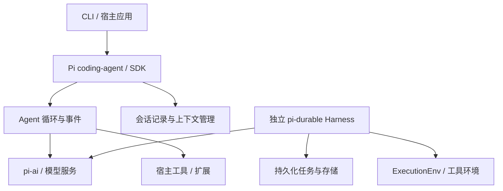

# Pi Harness 架构职责

## 包结构

根据官方包说明整理；这是职责图，不是企业部署拓扑。[P1][P4][P6]

| 包 | 职责 | 不应推定的能力 |
|---|---|---|
| pi-ai | 多模型服务统一访问 | 自行托管模型推理 |
| pi-agent-core | 有状态循环、工具和事件 | 默认具备进程故障恢复 |
| pi-coding-agent | CLI、会话与可扩展 Harness | 云租户管理与 SLA |
| pi-tui | 终端界面库 | Web 控制台 |
| pi-durable | 实验性持久化会话／任务 | 任意工具副作用只发生一次 |
| chord | 应用组合及文档状态运行能力 | AgentCore 式基础设施服务 |

## 上下文与执行状态

agent-core 在模型调用前区分上下文转换与模型消息转换，这使 UI／业务消息可以与模型输入分开。[P4] 会话文档描述继续、分支和压缩等用户操作。[P5] 记录对话与恢复执行应分别判断。

当前 pi-durable 提供另外的持久化 Harness，以存储提交和任务检查点组织恢复。其文档区分可以安全重放的工具和被中断的工具；外部效果仍需工具自己的幂等设计。[P6] 本次只核对文档，不宣称完成故障注入验证。

[来源](sources.md) · [产品概览](README.md)
