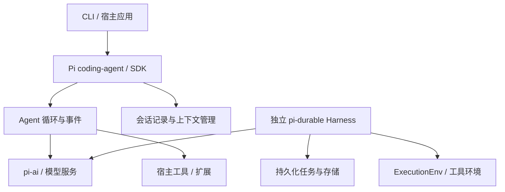

# Pi Agent 详细调研

证据基线为 2026-10-10；2026-10-12 调整阅读结构并补充定位与架构分析。未新增部署实验。本次复核固定提交下 P4 的 agent-core 文档，其余基线未变。

[先读摘要](summary.md) · [产品索引](../README.md)

## 阅读路线

从定位与边界开始，继而理解软件组件、典型执行路径和设计取舍；定制、托管与费用用于解释架构的实际边界。图和调用解释是公开资料的研究视图，源码证据只覆盖注明的组件，不推定未公开的内部拓扑。

## 产品定位与边界

### 面向谁，核心侧重点是什么

Pi 的官方定位是可扩展 Harness。[P1](https://github.com/earendil-works/pi/blob/42a3497d03ad17e308a2299fa824727894f2c0ec/README.md)[P2](https://github.com/earendil-works/pi/blob/42a3497d03ad17e308a2299fa824727894f2c0ec/packages/coding-agent/README.md) **研究判断：**它主要面向想直接使用或改造 Agent 的开发者，以及希望把 Agent 执行嵌入已有软件的宿主开发者。核心问题是如何用可组合接口管理模型循环、工具和交互，而不是先定义企业云资源体系。

因此包之间的契约比云服务清单更重要：宿主怎样提交输入，怎样接收事件，怎样改变工具，怎样选择运行环境。它既可被做成最终用户工具，也可作为更大平台中的执行组件；这两种角色对应不同运营责任。

### 范围与结论

此处将用户所称 Pi Agent 解释为原 `badlogic/pi-mono` 的 Pi Harness／coding-agent，未研究 Inflection 的同名聊天产品。旧地址当前跳转到 `earendil-works/pi`。查阅日期：2026-10-10；源码引用为 `42a3497d03ad17e308a2299fa824727894f2c0ec`，未安装或运行。

Pi 是可扩展的 Agent Harness，同时仓库提供模型访问、Agent 循环、TUI 和持久化运行库。它的主要交付形式是本地 CLI 和可嵌入 SDK，而不是与 AgentCore 等价的云托管控制面。[P1](https://github.com/earendil-works/pi/blob/42a3497d03ad17e308a2299fa824727894f2c0ec/README.md)[P2](https://github.com/earendil-works/pi/blob/42a3497d03ad17e308a2299fa824727894f2c0ec/packages/coding-agent/README.md)

定制重点是扩展、技能、提示词模板和代码集成。CLI 支持交互、自动化输出与 RPC 控制；SDK 允许嵌入自己的应用。这种扩展性适合平台设计者研究，但不是面向非程序员的可视化低代码平台。[P2](https://github.com/earendil-works/pi/blob/42a3497d03ad17e308a2299fa824727894f2c0ec/packages/coding-agent/README.md)[P3](https://github.com/earendil-works/pi/blob/42a3497d03ad17e308a2299fa824727894f2c0ec/packages/coding-agent/docs/extensions.md)

## 软件架构

### 包结构

根据官方包说明整理；这是职责图，不是企业部署拓扑。[P1](https://github.com/earendil-works/pi/blob/42a3497d03ad17e308a2299fa824727894f2c0ec/README.md)[P4](https://github.com/earendil-works/pi/blob/42a3497d03ad17e308a2299fa824727894f2c0ec/packages/agent/README.md)[P6](https://github.com/earendil-works/pi/blob/42a3497d03ad17e308a2299fa824727894f2c0ec/packages/durable/README.md)

| 包 | 职责 | 不应推定的能力 |
|---|---|---|
| pi-ai | 多模型服务统一访问 | 自行托管模型推理 |
| pi-agent-core | 有状态循环、工具和事件 | 默认具备进程故障恢复 |
| pi-coding-agent | CLI、会话与可扩展 Harness | 云租户管理与 SLA |
| pi-tui | 终端界面库 | Web 控制台 |
| pi-durable | 实验性持久化会话／任务 | 任意工具副作用只发生一次 |
| chord | 应用组合及文档状态运行能力 | AgentCore 式基础设施服务 |

### 上下文与执行状态

agent-core 在模型调用前区分上下文转换与模型消息转换，这使 UI／业务消息可以与模型输入分开。[P4](https://github.com/earendil-works/pi/blob/42a3497d03ad17e308a2299fa824727894f2c0ec/packages/agent/README.md) 会话文档描述继续、分支和压缩等用户操作。[P5](https://github.com/earendil-works/pi/blob/42a3497d03ad17e308a2299fa824727894f2c0ec/packages/coding-agent/docs/sessions.md) 记录对话与恢复执行应分别判断。

当前 pi-durable 提供另外的持久化 Harness，以存储提交和任务检查点组织恢复。其文档区分可以安全重放的工具和被中断的工具；外部效果仍需工具自己的幂等设计。[P6](https://github.com/earendil-works/pi/blob/42a3497d03ad17e308a2299fa824727894f2c0ec/packages/durable/README.md) 本次只核对文档，不宣称完成故障注入验证。

## 一次请求如何执行

以 agent-core 的公开消息与事件说明为基础，宿主程序可以替换具体工具和界面。[P3](https://github.com/earendil-works/pi/blob/42a3497d03ad17e308a2299fa824727894f2c0ec/packages/coding-agent/docs/extensions.md)[P4](https://github.com/earendil-works/pi/blob/42a3497d03ad17e308a2299fa824727894f2c0ec/packages/agent/README.md)

1. CLI 或宿主应用提交用户输入，Agent 将其组织为消息和上下文。
2. transformContext 处理上下文，再由 convertToLlm 将应用消息转换为模型可理解的消息；界面或业务消息不必原样发送给模型。
3. pi-ai 对接模型服务。响应与工具执行进展形成事件，供界面或宿主订阅。
4. 如果模型选择工具，运行逻辑执行相应工具、加入结果并继续循环；没有后续工具动作时形成回答。
5. 会话层可管理记录与分支。需要崩溃恢复时，应另外选择并验证持久化方案；独立 pi-durable 提供其自己的存储、任务与重放契约。

这是包级执行关系，不假定 coding-agent 所有路径都直接复用相同函数，也不假定 CLI 默认运行在 durable Harness 上。

## 架构如何支撑产品定位

**研究判断：**Pi 的可改造定位解释了模型访问、循环和交互分包的价值：宿主可以消费事件、替换工具或嵌入 SDK，不必接受完整云平台的资源模型。轻量核心也意味着平台特有的审批、租户与调度要由宿主补齐。

Pi 默认继承启动进程权限，因此“注册一个工具”同时涉及行为能力与宿主权限。扩展执行钩子和运行环境的 OS 边界是两种机制，不能把前者当作后者。[P1](https://github.com/earendil-works/pi/blob/42a3497d03ad17e308a2299fa824727894f2c0ec/README.md)[P3](https://github.com/earendil-works/pi/blob/42a3497d03ad17e308a2299fa824727894f2c0ec/packages/coding-agent/docs/extensions.md)

当前基线独立列出实验性的 pi-durable，它把恢复组织为存储提交与任务步骤。[P6](https://github.com/earendil-works/pi/blob/42a3497d03ad17e308a2299fa824727894f2c0ec/packages/durable/README.md) 这是重要的架构方向，但其成熟度和与其他包的组合关系应单独研究，不能用该包文档给整个 Pi CLI 作恢复保证。

## 定制与运行边界

### 定制粒度

| 方式 | 修改对象 | 对开发者的要求 |
|---|---|---|
| 提示词模板／技能 | 可复用指令与任务方法 | 明确适用条件和输入 |
| Extension | 工具、事件、命令、交互与执行钩子 | 编写并维护扩展代码 |
| RPC | 外部程序控制 Agent | 维护进程与协议接入 |
| TypeScript SDK | 嵌入应用会话和运行逻辑 | 设计应用生命周期 |

扩展可改变工具和交互；能拦截某个工具事件不等于操作系统权限边界。平台选择应分别评估提示词自由度、程序扩展与执行权限。[P2](https://github.com/earendil-works/pi/blob/42a3497d03ad17e308a2299fa824727894f2c0ec/packages/coding-agent/README.md)[P3](https://github.com/earendil-works/pi/blob/42a3497d03ad17e308a2299fa824727894f2c0ec/packages/coding-agent/docs/extensions.md)

### 企业托管需要宿主补齐什么

官方明确说明 Pi 默认继承启动用户／进程权限，没有内置的文件、进程、网络和凭据限制系统。容器、microVM 或策略沙箱是额外的部署模式，应验证覆盖范围。[P1](https://github.com/earendil-works/pi/blob/42a3497d03ad17e308a2299fa824727894f2c0ec/README.md)

| 企业职责 | 当前调研结论 |
|---|---|
| 租户身份／RBAC | 在研究的 CLI／库范围内未确认统一企业控制面 |
| 资源隔离 | 由宿主或额外沙箱提供；工作目录分开不足以证明隔离 |
| 凭据与网络 | 宿主管理；插件和工具的访问范围需控制 |
| 伸缩和调度 | 宿主运营者设计进程、队列与容量 |
| 观测与持久化 | 可利用库能力，平台仍需集成、备份和留存策略 |
| 版本治理 | 固定包版本与依赖，验证扩展兼容性 |

这是调研范围内的责任判断，不是“Pi 不能用于企业”。它可以成为企业平台的执行组件，但其组件扩展性不能代替完整平台治理。

### 恢复边界

pi-durable 文档说明持久化存储、恢复调度以及工具的重放策略，且 API 标为实验性。采用时需要故障注入证明是否按预期返回中断结果，尤其不能把 requestId 去重视为外部支付／写入动作的原子事务。[P6](https://github.com/earendil-works/pi/blob/42a3497d03ad17e308a2299fa824727894f2c0ec/packages/durable/README.md)

## 待验证事项

研究判断：轻量 Harness、执行事件和宿主环境分离有利于嵌入既有平台。企业采用时仍要另外设计租户身份、隔离与运维。

需实测扩展拦截是否覆盖全部工具入口、RPC 断连后作业行为、会话恢复和版本兼容。当前独立 `pi-durable` 明确标为实验性，需单独验证其重启及工具重放机制，不能把它的保证套到全部 CLI 和 agent-core API。[P6](https://github.com/earendil-works/pi/blob/42a3497d03ad17e308a2299fa824727894f2c0ec/packages/durable/README.md)

## 参考来源

查阅日期：2026-10-10。旧仓库地址重定向至 earendil-works/pi，源码基线 `42a3497d03ad17e308a2299fa824727894f2c0ec`。依据包文档，未安装、未测试；main 不等于已发布稳定版本。

| 编号 | 官方来源 | 支持范围 |
|---|---|---|
| P1 | [仓库 README](https://github.com/earendil-works/pi/blob/42a3497d03ad17e308a2299fa824727894f2c0ec/README.md) | 包关系、权限与定位 |
| P2 | [coding-agent README](https://github.com/earendil-works/pi/blob/42a3497d03ad17e308a2299fa824727894f2c0ec/packages/coding-agent/README.md) | Harness 与入口 |
| P3 | [Extensions](https://github.com/earendil-works/pi/blob/42a3497d03ad17e308a2299fa824727894f2c0ec/packages/coding-agent/docs/extensions.md) / [SDK](https://github.com/earendil-works/pi/blob/42a3497d03ad17e308a2299fa824727894f2c0ec/packages/coding-agent/docs/sdk.md) | 定制与嵌入 |
| P4 | [agent-core](https://github.com/earendil-works/pi/blob/42a3497d03ad17e308a2299fa824727894f2c0ec/packages/agent/README.md) | 循环、消息和事件 |
| P5 | [Sessions](https://github.com/earendil-works/pi/blob/42a3497d03ad17e308a2299fa824727894f2c0ec/packages/coding-agent/docs/sessions.md) | 会话操作 |
| P6 | [pi-durable](https://github.com/earendil-works/pi/blob/42a3497d03ad17e308a2299fa824727894f2c0ec/packages/durable/README.md) | 实验性持久化与重放 |

## Knowledge Extraction

- [x] 将仓库迁移、包职责及实验性状态纳入调研技能。
- [ ] CLI 与 durable 组合行为待实验。
- [x] 2026-10-12 将报告重心调整为产品定位与软件架构，定制和托管作为辅助解释。

[返回摘要](summary.md)
