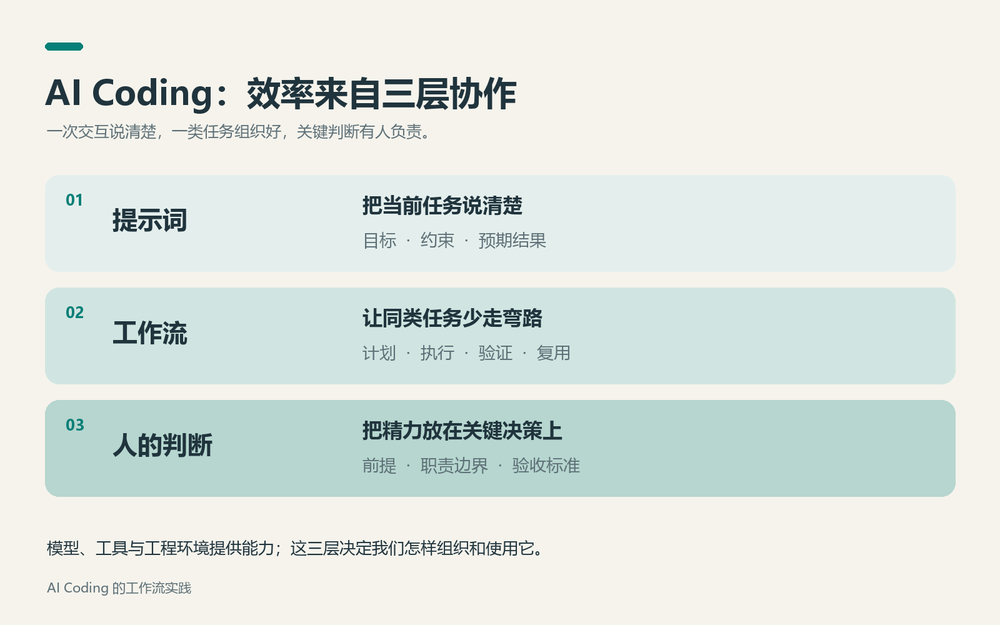
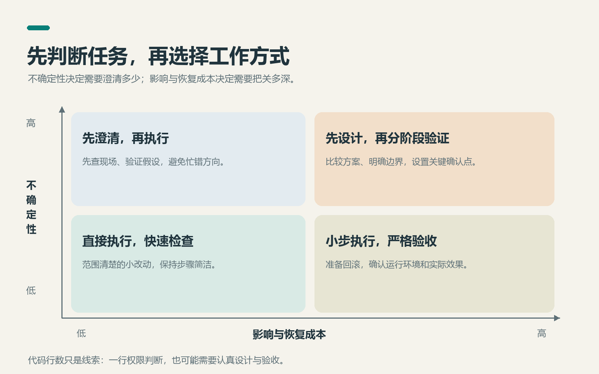

# AI Coding 的工作流实践

> 写作日期：2026-10-08

---

## 一、效率的终点是工作流

聊 AI Coding 效率，大多数讨论停在提示词层：怎么把一句话说得让 AI 听懂。这没错，但只对了一层。我的体会是，效率由三层东西共同决定，一层比一层深：

1. **提示词质量决定开发效率。** 一句话需求和一份详细的需求描述，交给 AI 的结果天差地别——这是最直观的一层。
2. **工作流决定开发效率。** 同类任务第二次出现时，你能不能快速形成 plan、不再从零探索——这一层不看单次交互，看的是可复用性。
3. **人决定开发效率。** 越是你懂的领域，你验收得越准、纠偏得越快，AI 的产出就越好——这一层是上限。

三层不是并列，是叠起来的：提示词作用于一次交互，工作流作用于一类任务，人的领域理解影响目标、边界和验收质量。模型能力、工具和工程环境也会限制结果；这里讨论的是开发者能够主动改善的三层。

为什么我把工作流抬到"基础设施"的高度？因为模型和工具越来越容易获得，同样的工具，组织方式不同，产出也会不同；工作流就是把这些组件组装成产能的那一层，需要持续投入，也能长期复用。AI 越强，执行越便宜，这一层的决定性越大。过去三周我在一个项目里与 AI 协作，少量指令就能触发大量查阅、修改和检查。工具调用多，不等于工作完成得好；我越来越需要关注的是，怎样减少返工，让这些执行最终变成可用结果。

本文按这三层展开：第二章讲提示词层，第三、四章讲工作流层，第五到七章讲人，第八章用项目中的具体案例补充这些习惯如何落地。

## 二、流程不能省——需求、设计、开发、测试还是那几步

用了 AI 之后最容易产生的错觉，是"流程可以省了"：不写需求文档，不做设计，一句话直接开干。我的结论是——目标、方案、实现、验证这几件事仍然要有人负责，但不必每次都写成四份文档。小改动可以在几句话里走完，复杂任务才需要正式展开。因为**你比 AI 更容易超上下文**。

AI 可以借助长上下文、检索和摘要保存大量信息；你开会时记得住的内容，和下班前剩下的耐心，通常没有那么充裕。跳过设计直接进一条长对话，先撑不住的不是 AI，是你：你得在脑子里同时维持需求、方案、改动范围和已经排除的错误路径，系统每复杂一分，你的把握感就少一分。流程阶段的本质，是**人自己的外置上下文管理**——需求文档、设计文档、测试计划，每一样都是把"必须记住的东西"从你脑子里挪到纸面上。流程不是形式主义，是给人的注意力装的护栏。

落到提示词层，"一句话需求"和"详细的需求描述"的差别，在 AI 时代被放大而不是缩小了。我最长的一条会话，开局是一句话加一份 16,393 字符的规格文档，里面写清了"本次需要实现 / 本次不实现"的清单、错误码、测试计划和验收标准，还注明"当前工作区应保持干净"——这条会话一次成型，没有跑偏。回看全部记录，超过 100 字的长输入我只发了 17 条，但它们对应的恰恰是工具调用量最高的两条会话（35 轮 721 次、109 轮 932 次）。规律很清楚：**口头交代的任务是轻任务，文档交代的任务是重任务**——前面把关键约束说清楚，往往比后面反复返工划算。

具体到执行节奏，就是**先 plan 后 coding**：plan 本身是一个独立交付物——方案、改动范围、影响面先摆出来，你点头了才动代码。它比"先分析后动手"更进一步：分析可以只是看，复杂任务的 plan 应当成文，并在关键决策处由人确认；范围清楚的小修复，用几句话交代计划即可。plan 批准那一下，是你成本最低的验收点——改一行 plan 是几秒钟的事，返工一段已经写错的代码是几十分钟的事。

怎么做：

- **写"不做什么"比写"做什么"更防跑偏。**"本次不实现"清单是最有效的护栏，可以减少 AI 顺手“优化”无关代码的机会。
- **讨论与动手严格分家。**"先定位根因，先不要着急修改""先讨论再进行修改"是我最常用的两句口头禅——先分析后动手，是零成本的保险丝。
- **开工前把需求、边界、验收标准落成文字。**这份文档不只是给 AI 的输入，更是给你自己的上下文减负。

## 三、按流程切会话——上下文管理是工作流思维的自然结果

会话可以按流程切，但不必机械地一阶段一条。需求、设计、开发、测试有不同的目标；当话题切换、探索积累了太多弯路，或者需要独立评审时，另开会话往往更清楚。目标稳定、上下文仍然有效时，继续原会话也能省掉交接成本。切会话的依据是任务和信息质量，不是聊天条数。

换会话前留下四样东西：**目标与边界、已确认的决策、当前代码与环境状态、下一步验收标准。**否则新会话虽然干净，也可能把刚排除的方案重新研究一遍。换会议室之前，记得把白板拍下来。

我的记录是这样的：34 个会话里，大量是 1–3 轮就结束的短会话——"梳理大颗粒管理面功能与数据库"1 轮，"调研 ccswitch"2 轮。话题结束就另起一条，从不在同一条会话里换题。三周里我触发过 10 次上下文压缩，**全部手动**，整个库没有一次自动压缩——都是在上下文"腐烂"之前自己动手，典型的一次把 869,563 token 压到 21,358：扔掉的是弯路，留下的是结论。探索性的岔路走支线，fork 出去聊几轮再回主线，不污染主线。要结论时我会说"不要落盘，直接给我一个可以复制的版本"——不让中间产物变成文件、再变成后续上下文里的噪音。

有一个反直觉的数据要交代：我的缓存命中率 98.94%，单条会话的上下文峰值到过 81 万 token——长上下文的货币成本其实很便宜。所以切会话、手动压缩，省的都不是钱，是**信噪比**。在我的实践里，更直接的收益是注意力和信息质量；费用仍取决于模型、计费方式和缓存情况。

怎么做：换题另开会话；探索走支线；要结论就说"不要落盘"；长会话在信噪比恶化前主动压缩，不等自动触发来兜底。

## 四、重复的工作流，沉淀成 skill

工作流建起来的第三步是固化：同样的事反复出现，就值得评估能否沉淀成 skill。“第三次”是提醒自己观察重复的信号，不是硬性门槛。skill 是工作流的代码化——提示词沉淀的是一次交互，skill 沉淀的是一整段流程；写一次，之后每次调用都是同一条流水线。

先破除一个顾虑："我哪有精力先把工作流定义完整？"没人能。**定义完整的工作流，本身就是一个逐步积累的过程**：不是先设计出完美流程再开工，而是边干边识别重复、边沉淀，每次比上次多攒一点。三层模型里"工作流决定效率"的落点正在这里——同类任务第二次出现时，已有的沉淀让你跳过探索、直接形成 plan。

两个第一手的实例，都来自这个笔记仓库：

- [`atomic-knowledge`](../../.agents/skills/atomic-knowledge/SKILL.md)：把"随手记一条知识"固化成固定格式的原子笔记流水线——一句短请求进，一条合乎规范的笔记出。
- [`knowledge-distillation`](../../.agents/skills/knowledge-distillation/SKILL.md)：把"阶段性总结"固化成从业务工作提炼可复用知识的流程。

没有 skill 之前，沉淀靠自觉和心情，做了不一定记，记了不一定规整；有了 skill，沉淀是一个可以调用的动作，更容易保持格式和步骤一致，但仍需要维护、检查和随环境更新。

怎么做：识别信号——同类事做到第三次，停下来花十分钟沉淀；判断粒度——动作能标准化的才值得做成 skill，一次性的判断不值得。

## 五、AI 是工具，人是核心——两种控制权

"AI 只是工具，人是核心"这句话人人会说，但它是可以落到操作上的：人行使两种控制权——**过程控制靠及时纠偏，结果控制靠明确验收与授权边界**。

**过程控制：及时打断，不等它跑完。**三周里我主动中断了 32 次；其中一条 14 次中断的会话里，12 次"停下"与我的新指令时间戳相差不超过 0.2 秒——是边跑边插话，不是跑完再批评。几句最有代表性的原话：

- "先不分析了"——五个字，AI 当场放弃一条耗时排查线。
- "卡片被我删除了"——一句现实修正，省掉它翻遍日志去找一张不存在的卡片。**喂现实比喂数据高效。**
- "不需要，只检查管理面的服务就行"——立即收窄范围。
- "不要再修了，类似问题太多了，这是没有穷尽的，我理解还是先总结方案，再审视方案"——这句把整条会话从"报错-修复"的死循环里拔了出来。**发现陷入循环，就升一个层次**：停止修 bug，回头审方案。这不是放弃，是换层。
- 改动已经跑偏时，**用回滚代替矫正**。让 AI 在错误的地基上"改对"，它常常为了圆一个错而引出三个新错；回到跑偏前的检查点或提交，带着刚学到的教训重新下指令，比在烂摊子上缝缝补补快得多。前提是小步提交——回滚的粒度，取决于你提交的粒度。

**结果控制：按影响与恢复成本设置闸门。**我的执行模式 95.4% 是 yolo（3205 次），几乎全程放手；但同一份记录里，全项目只有 6 次"推送提交"指令，两个最长的排障会话全程零推送；部署前预设闸门——"开始部署之前找我确认"，并预先写死参数；关键决策点用提问收敛（10 次）；授权之前先要改动清单——"方案一修改哪里的代码？"

所以效率不是来自"敢放手"，而是来自**把影响大、恢复困难的动作单独圈出来确认，其他动作在清楚的授权范围内执行**。放手换速度，闸门换安全，两者不矛盾——前提是判断影响范围和恢复成本。推送、部署并非一概不可逆，本地操作也可能删除重要数据；动作名字只能提示风险，不能代替判断。

怎么做：插话不等待；喂现实不喂数据；陷入循环就升维；跑偏就回滚，不在烂摊子上矫正；按环境和影响列出需要确认的动作，例如生产部署、共享分支改写、重要数据删除；事先授权清楚，避免每一步都弹出一次审批。

## 六、边干边沉淀——每一次沉淀都是效率的提升

**能被找到、还能用、有人维护的沉淀，才会提高效率。**skill 和笔记让后续任务少走弯路，但也有整理和维护成本。把整段对话原样存起来，常常只是把聊天记录搬了个家。AI 时代最容易掉进去的坑，是"全程让 AI 干，自己什么都没留下"：任务完成了，能力没增长，下一个类似任务来时，你的起点和上次一模一样。

沉淀还直接决定验收能力。AI 写的代码你要能验收，而验收能力来自过程中持续的理解，理解需要落点。我的验收也不靠逐行读代码：让另一路 AI 出检视报告，整段回灌给写代码的 AI 按条修改；重要变更一次派 4 个子 agent 并行做代码评审。多个 AI 也可能共享同一处错误假设，互审不能替代独立的运行证据。但报告的结论我自己读——**检视可以委托，验收责任仍要有人承担**。

沉淀有三条通道：**工作流沉淀成 skill**（上一章，给机器复用）；**知识沉淀成笔记**（给自己和同事复用）；**约定沉淀成仓库文档**——在仓库根目录维护 AGENTS.md 这类文件，写清项目结构、编码规范、常用命令和已知坑。第三条性价比最高：一次写好，之后每条新会话自动加载，你不用在每条会话里重新教 AI 这个项目的规矩。前两条的实践就是这个笔记仓库：对话是一次性的，笔记是资产。手册类的沉淀（比如升级执行手册）放在代码仓库之外，和代码的生命周期解耦。

怎么做：任务收尾固定加一步"这次学到了什么"；用 AI 互审补充检视，结合测试和实际行为判断结论；交付物按"能直接交给下一个人"的标准生产——我的原话是"给我一份完整的能指导开发的文档，我要粘贴给其他人，他直接上服务器开发"；AGENTS.md 随坑更新——每次踩到项目级的坑，顺手补一行，文档是活的，不是一次写完的。

## 七、对开发者的要求更高了——跳过阶梯，直接做设计

**要求高在哪。**过去的开发者先学语法，再从简单任务上手：函数、模块、设计，一级一级往上走，经验和职责同步增长。AI Coding 让人更早接触设计与验收问题：做什么、不做什么、怎么验证。它们不全是架构决策，却都需要判断力；学习实现细节的阶梯仍然值得走。跳过前序步骤不等于不需要那些能力，而是要求你在还没写过一行实现之前就具备它们。

**怎么满足。**按不确定性和影响选起手式：**目标清楚、影响小，就直接执行；边界不清、影响大，就先澄清和设计。**改动规模只是信号之一，一行权限判断也可能比几十行页面样式更需要审慎。我的输入中位数是 34 个字，最短的一条只有一个字——"推"。小任务方向明确，直接执行；而大任务的开局是那份 16,393 字符的规格文档，先把抽象、边界、验收标准聊透再动手。同一个人，两种形态，切换的依据就是任务规模。接任务先判断未知条件和失败代价，再决定讨论到什么深度。

**为什么没有万能经验。**任务规模一变，方法论就变——所以没有什么经验能无敌于世，收藏别人的最佳实践救不了你的下一个任务。你需要的不是抄作业，而是持续产生新思路、新观点的能力。工作流这座基础设施也一样：不是建成后一劳永逸，要随任务演进出新的版本。

## 八、从项目会话里提炼的六个习惯

下面这些习惯，是从具体任务中的追问、纠偏和验收动作提炼出来的。它们是这批会话呈现的倾向，不意味着每次任务都严格遵循同一套流程。

### 1. 把其他 AI 的方案当作待验证的输入

我经常带着已有方案进入会话，但下一步仍是要求 AI 对照当前代码核查，而不是照单实施。构建卡死的任务里，我给出了相当完整的方案，最后的指令仍是：“确认下问题是否存在，判断下方案是否合理”。拆分提交时，我也先问既定顺序和拆分方案是否合理。

这个习惯的价值，是把“方案写得完整”和“方案符合现场”分开。提交拆分的案例中，AI 核查发现方案里准备移除的 `0db131b` 实际已经是主线基点。未经核查就执行，一份看似具体的计划也可能制造额外工作。

**我的做法：先让 AI 证明问题和前提，再评估方案；旧会话里的分支、提交和部署状态，都要重新对照现场。**跨 AI 交接时，传递目标、已知事实和待验证假设，比只传递一个结论更可靠。

### 2. 追问修改的必要性，主动删掉过度设计

构建卡死修复完成后，我的反馈是：“代码已经修改完毕，但是改的太多了，有没有最小化修改，只在模块挂死的时候直接做一下状态变更？”我关注的是任务状态能否退出卡死、用户能否重试，而不是顺便把整个恢复体系做完整。

配置与跳转设计中也有同样的倾向：我要求 Gateway 地址沿用已有部署配置，网桥地址先用模板默认值，不让管理面承担探测和自动设置。这里的判断依据很具体：“这个 IP 生效的时机不在管理面”。这次收敛最终撤掉了额外的网桥自动化脚本。

**我的做法：每增加一个配置、脚本或跨模块改动，都问它是不是本次闭环所必需，已有机制能不能复用。**最小修改也要保住正确性：例如转发的 token 必须与本次认证身份来自同一份凭据，这类约束不能为了少改几行而省掉。

### 3. 用职责边界审代码，不只问功能通不通

当跳转功能改到了鉴权模块，我没有直接接受，而是追问：“为什么对鉴权服务也有修改，这是必要的吗？”随后又明确：“我这个 token 就是转发给 gateway，剩下的处理逻辑都在 gateway 这里。”

这类追问迫使 AI 解释调用关系：管理面为什么需要原始 token，哪些验证属于管理面自身，哪些逻辑应该留给 Gateway。在后续架构讨论中，我又提出 Runtime Adapter 与 Interaction Adapter 的划分，围绕“怎么跑起来”和“怎么通信”检查抽象。

**我的做法：验收时多问一句，为什么应该由这个模块负责？**边界清楚以后，才能判断某个改动是必要配合，还是职责蔓延；也更容易发现多个模块各自维护同一份配置的问题。

### 4. 验收看用户结果，并追到实际运行版本

重复上传修复中，AI 报告测试通过后，我仍反馈：“前端显示没变化，修改没有生效吗？”此前我指出的也不是内部实现细节，而是用户看到的结果：重复报错、英文摘要、不该出现的“重试构建”按钮，以及相同包是否还会进入构建。

我进一步要求失败展示归一到已有的构建任务小窗。这是在用产品行为约束实现：同一种失败体验沿用现有入口，不为每个后端异常再增加一套交互。

联调时，我还提供了 `dai → daidai → dai` 的用户切换序列：老用户成功、新用户失败、切回又成功。这个对照帮助排查区分身份隔离问题与新用户首次启动问题。

**我的做法：测试通过之后，还要走实际页面；反馈时给操作序列、用户差异、预期与实际。**若页面没变，就继续核对构建、部署、运行镜像和浏览器资源。代码已修改、检查已通过、服务已更新、用户已验收，是四个不同的完成状态。

### 5. 给探索搭一个可控环境，把变量拆开

验证模型配置时，我要求先搭本地 Mock 服务：兼容 OpenAI API，模型查询返回 `model1`、`model2`，再让 `litellm` 和 `myserver` 两个 Provider 指向同一个服务。

这个请求的意义，是先固定模型服务这一端，集中验证 Agent 的配置读取、Provider 差异和模型发现行为。如果直接连接复杂的真实服务，网络、鉴权、模型可用性和 Agent 配置会同时成为变量，失败后很难知道是哪一层。

**我的做法：排查跨系统问题时，先用一个已知响应、可重复操作的环境验证其中一段，再回到真实链路。**Mock 可以帮助定位问题，但不能替代最终的真实服务联调。

### 6. 用可验证的功能组织提交，把结果交给下一个人

整理提交时，我明确提出目标：“可以拆成几个 PR 分开提交且功能都是可以进行独立验证的”，并给出“镜像上架 → 配置文件写入 → 跳转 → 个人工作台重构”的顺序。这里关心的不是提交数量，而是每个阶段能否部署、验收、解释和回滚。

有依赖的功能可以堆叠，但每个阶段都应有明确验收点。跨前后端和部署配置的改动，如果共同完成一个用户功能，也不必为了按目录拆分而制造不可用的中间状态。

我也会追问改动多少行、去掉 UT 后净修改多少，要求简短 PR 标题与描述、总结验证步骤。这些动作让 AI 交付的东西更容易被人审查和接手。代码行数可以帮助发现范围膨胀，但不能单独代表效率或质量。

**我的做法：完成标准里包含“下一个人怎么检视、怎么验证”。**让 AI 提供功能边界、依赖、验证结果和未验证项，比一句“已完成”更有用。

这六个习惯可以串成一条实际工作流：**带入目标和初步方案 → 核实现场 → 收窄范围与职责 → 小步实现 → 在真实运行环境验收 → 整理可交接的提交与记录。**人的精力集中在前提、边界和验收上，AI 承担查代码、实现和执行检查。

## 九、结语：工作流是个人与团队的基础设施

工作流不是一次设计出来的，是一次次沉淀攒出来的——复利从第一次沉淀就开始。

个人层面，你的 skill 库、会话习惯、知识库是复利资产：具体提示词会随模型迭代调整，工作流和知识也要更新；能够带走的，是识别问题、组织执行和验证结果的能力。团队层面，谁先定义好工作流，谁就定义了产能上限——个人工作流只复用自己的时间，团队工作流被所有成员复用，这才是"基础设施"的完整含义。

三层模型收个尾：提示词决定单次效率，工作流决定同类任务的效率，人决定上限。三层都要经营——而 AI 越强，"人"这一层的权重只会越来越大。

## Knowledge Extraction

- [ ] Review which conclusions remain valid outside this task or release.
- [ ] Update existing atomic knowledge before creating a new note.
- [ ] Link extracted knowledge here and add this document under its `Applied In` section.
