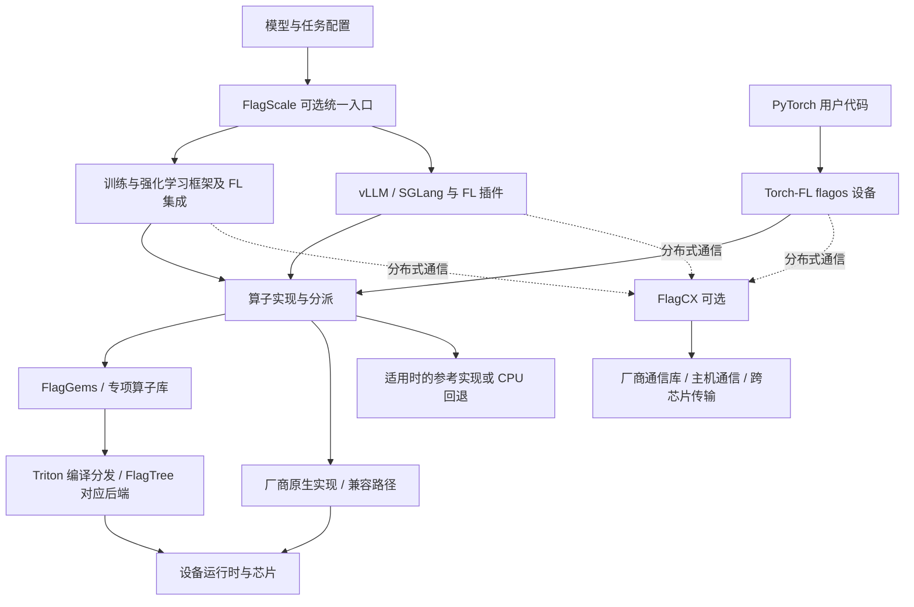

# FlagOS 详细调研：定位、组件架构与多芯片适配边界

调研日期：2026-10-15。本文调研 GitHub 组织及核心软件栈，采用官方文档核验与局部接入代码阅读，未进行安装、硬件实验、完整源码走读或性能复现。事实描述均限定于下列来源快照；分析性结论标为研究判断。先读 [摘要](summary.md)。

## 定位与研究范围

官方将 FlagOS 定位为面向多芯片场景的统一开源 AI 系统软件栈，希望降低模型开发者跨芯片迁移与维护成本。组织按算子、编译器、通信、框架、训练等 SIG 划分工作，另有 KernelGen、评测、具身智能等方向。[S1]

本轮聚焦三个问题：统一接口在哪一层实现；算子、编译器与通信如何配合；这些机制对现有 vLLM Ascend／310P 适配有什么参考价值。未逐仓库审计组织中的全部项目，也未评价 KernelGen 的生成质量或机器人方案。

研究判断：其主要受众是基础软件开发者和平台适配团队。对模型用户，它争取保留熟悉的框架接口；对芯片厂商，它提供可共享的接入层；对基础设施团队，它提供减少重复适配的可能性。组织中出现 skills 或 Agent 相关方向，并不能改变主栈以模型计算和通信为中心的定位。

## 软件架构

以下为依据公开职责重建的研究视图，并非官方部署图。箭头表示可能的调用或集成关系，不表示所有组件都必须安装，也不表示独立服务边界。

### FlagScale：统一任务入口

当前 README 说明 FlagScale 通过统一配置与 CLI 集成训练、强化学习、推理等后端；列出 Megatron-LM-FL、TransformerEngine-FL、verl-FL 和 vllm-plugin-FL 与各上游的关系。2026 年 3 月的说明将 v1.0.0 称为首个稳定版本，并明确硬件相关支持已移到插件仓库，旧版本用户应关注 `main-legacy`。[S5]

研究判断：理解新版应区分“任务组织入口”和“硬件执行适配”。旧版 FlagScale 的实现描述不能自动套到当前 main；FlagScale 的模型示例也不能证明整个 FlagOS 软件栈在所有硬件上的完整支持。本文只核验其公开职责和迁移说明，没有审阅任务启动器的完整实现。

### FlagGems：算子实现与 ATen 接入

FlagGems 用 Triton 实现通用算子，官方强调可用于 eager 模式，并不依赖 `torch.compile`。局部源码中可见 `torch.library.Library("aten", "IMPL")`、算子配置表及 `SpecOpRegistrar`／`GeneralOpRegistrar`，支持其通过 ATen 注册和后端特化组织算子的描述。[S2]

这里的两种扩展不可混同：普通 PyTorch 算子可通过 ATen 接入；推理框架的融合算子、专用模型实现还需要框架插件或相应专项算子库。组织另列 FlagGems-vllm、FlagGems-sglang、FlagAttention、FlagBLAS 等项目，本轮未核验其完整覆盖。[S1]

研究判断：在共享 Triton 实现的同时保留硬件特化，有利于复用语义与通用代码，但跨芯片性能仍取决于布局、数据类型、shape、编译器及特化实现。后端数量不能代替目标模型的算子覆盖率。

### FlagTree：多后端编译与版本分支

FlagTree 来自 Triton，负责多 AI 芯片的自定义算子编译。当前 README 的后端表将多个后端列在 main／Triton 3.6，将 Ascend 列在 `triton_v3.5.x`／Triton 3.5，并保留其他版本分支。官方明确各保护分支地位相同，后端可能同时支持多个 Triton 版本。[S3]

TLE 按 Lite、Struct、Raw 等层次扩展控制能力，其可用性也按后端分别列出。研究判断：统一编译生态与保持硬件优化空间之间存在取舍，更贴近硬件的扩展不能未经验证就视为可移植。不能将 Triton 版本号、FlagTree 发布号及厂商 wheel 后缀当成同一种版本。

### FlagCX：通信接口与异构执行

FlagCX 复用各厂商原生 collective 通信库，并描述 device-buffer IPC、device-buffer RDMA 等用于设备间传输的机制；同时列出 BOOTSTRAP、GLOO、MPI 等主机通信方式，以及 PyTorch／Paddle 集成。[S4]

它与算子编译是并行职责：本地 kernel 解决计算，collective／P2P 解决设备或进程之间的数据交换。接口统一不证明任意芯片组合具有相同的传输和集合通信能力。官方表按 Homo／Hetero 分开；当前 HCCL 列的 send、recv、allreduce 等条目为同构支持、异构不支持。不能用组织总体“跨芯片”定位覆盖这个具体边界。[S4]

### 框架接入：三种路径分别看

| 路径 | 接入方式与职责 | 证据层级 |
|---|---|---|
| Torch-FL | PyTorch `PrivateUse1` 注册 `flagos` 设备，逐算子路由到编译 kernel、原生厂商 kernel、兼容 boxing 或显式 CPU fallback | 官方 README 与平台安装指引；未审完整路由源码 [S6] |
| vllm-plugin-FL | 平台和通用插件入口、模型兼容钩子、算子适配及可选通信集成 | 阅读 `pyproject.toml` 和分派管理器等局部源码 [S7] |
| sglang-plugin-FL | 文档描述 ATen 替换、融合算子 OOT hook／bridge、分布式通信三个接入层 | README 和 entry points 配置；未审完整 hook 实现 [S8] |

Torch-FL README 将平台状态细分为 Stable、Beta、Experimental、Runtime only，Ascend 当前列为 Beta。项目存在 compile、distributed 等能力不意味着每个平台均已验证。它还将 ATen 生成绑定约束到 PyTorch 2.10.x；这是该组件自己的兼容边界，不是整个 FlagOS 的统一版本要求。[S6]

## 典型执行路径与生命周期

以使用 FL 插件的 vLLM 推理为例，下面串起文档与局部代码能够支持的逻辑路径。[S7]

1. 安装时准备匹配的 vLLM、FL 插件、设备 SDK、算子库及编译后端；非 NVIDIA 指引使用 `VLLM_TARGET_DEVICE=empty` 构建上游 vLLM。
2. 框架经 `vllm.platform_plugins` 调用 `vllm_fl:register`，经 `vllm.general_plugins` 调用 `vllm_fl:register_model`。这是可核查的插件注册入口，不能据此推断所有模型都加载同一套钩子。
3. 模型执行遇到已适配算子时进入 FL 分派。`OpManager` 注册内建实现，按厂商过滤、可用性和全局／逐算子策略生成候选，再缓存选择结果。
4. 被选中的实现执行计算。走 FlagGems 的部分使用相应编译栈；并非每个算子都经过 FlagGems，也并非统一设备名意味着底层全部重写。
5. `call()` 在非 strict 模式下可尝试后续候选，记录失败实现；strict 模式首个错误即失败。代码还提供首次使用记录、I/O 诊断及策略 epoch 缓存失效。这些机制便于定位实际执行后端，但未证明异常后的所有算子都可安全重试。
6. 多卡路径按配置选择通信实现；README 将 FlagCX 安装列为可选。完整请求仍由 vLLM 执行，不能把 FlagCX 画成每个 kernel 的后续步骤。

状态与生命周期要分层理解：分派管理器维护进程内候选缓存、失败记录和 PID／fork 重置；这些是本地执行状态。会话请求、KV cache、任务 checkpoint、崩溃恢复和跨节点资源治理仍需分别检查宿主框架或任务系统。本轮没有建立 FlagOS 提供统一持久化恢复协议的证据。

## 定位与架构的关系及取舍

以下为基于上述机制的研究判断：

| 设计 | 带来的价值 | 必须承担的代价 |
|---|---|---|
| 复用上游框架，通过插件接入 | 保留熟悉接口，缩小直接改上游的范围 | 插件仍受内部接口、模型结构与上游版本演进影响 |
| 共享算子库与多后端编译 | 减少重复实现通用算子的工作 | 编译器、SDK、特化参数和数值行为仍须逐硬件验证 |
| 逐算子选择与回退 | 能渐进接入，便于精度定位和替换实现 | 跑通可能掩盖慢路径；回退行为和实际后端须可观测 |
| 原生通信库加跨芯片机制 | 复用厂商同构通信能力并扩展组合方式 | 异构拓扑、算子、传输路径及硬件组合矩阵更复杂 |
| 多仓库分工 | 能按编译器、算子和框架独立演进 | 集成方必须管理经过验证的组件组合，不能统一追 main |

这套设计降低的是重复适配的范围，而非保证模型在任意硬件上无需任何适配。性能收益须通过相同负载、配置和精度基线实验判断；本轮不转述宣传图中的速度倍数作为结论。

## 适用边界与部署约束

### 当前文档中的具体限制

- vLLM 插件兼容表将 `main` 对应到 vLLM 0.24.0、`release/0.2` 对应到 0.20.2；安装示例引用 FlagGems v5.3.4、可选 FlagCX v0.13.0。它们是文档给出的组合线索，并非本轮安装验证结果。[S7]
- 该插件 Ascend 指引使用 FlagTree Ascend 3.5 分发，并要求 `enforce_eager=True` 或 `--enforce-eager`。模型表、厂商表、图模式与多卡模式必须交叉核验，不能按列表作笛卡尔积。[S7]
- SGLang 插件 README 明确 piecewise CUDA graph 尚不支持，给出 `--disable-piecewise-cuda-graph`；文档区分常规 CUDA graph 与 piecewise 模式。该限制属于此插件快照，不能推广为全部 FlagOS 组件的限制。[S8]
- Torch-FL 的 Ascend 安装前提写为 Ascend 910、CANN 9.0.0 或兼容版本，CPU PyTorch 2.10.x；FlagTree wheel 对 Python 版本还有限制。原生 ACLNN 与 FlagGems 路径并存，未覆盖的情况可能走 CPU fallback。[S6]
- FlagCX 的 HCCL 同构和异构支持不等价；即使 PyTorch 集成列出 HCCL，也不改变通信矩阵中的异构限制。[S4]

### 对本仓库 310P 研究的判断

本仓库已有 [310P CI 覆盖记录](../ci-coverage-matrix-310p.md) 与 [Qwen3-VL Ascend 适配设计](../qwen3-vl-ascend-adaptation-design.md)。FlagOS 可作为算子复用、编译适配和框架插件设计的参考，但本轮没有取得 310P 的完整支持证据。910 安装指引不能证明 310P 的指令、dtype、算子和图运行能力。

如要进入 PoC，建议分别验证组件，避免一次性切换整个软件栈：

| 阶段 | 固定条件与动作 | 要取得的证据 |
|---|---|---|
| 环境闭环 | 记录实际 310P 型号、驱动、CANN、Python、PyTorch、vLLM 与各组件 SHA | 可重复安装与加载，明确版本冲突和设备识别结果 |
| 最小计算 | 测 matmul、RMSNorm、RoPE 及目标 attention 路径 | 正确性、dtype／shape 边界、实际 kernel 和 CPU 回退记录 |
| 单卡模型 | 选择能容纳的文本模型，再覆盖 Qwen3-VL 视觉路径 | prefill／decode 正确性、显存、失败算子和 eager 限制 |
| 多卡通信 | 先验同构 collective，再跑模型并行 | 通信正确性、挂起定位、拓扑与实现路径；异构另立实验 |
| 性能比较 | 对照既有 vLLM Ascend，固定精度、输入输出长度、并发和模式 | TTFT、TPOT、吞吐、显存及回退比例，避免单算子结果替代端到端表现 |

此表为后续验证设计，所有实验均未执行。不能据此宣称比现有 vLLM Ascend 方案更快或更稳定。

### 许可与交付

组织介绍概括采用 Apache-2.0，但项目应单独核验：FlagGems、FlagCX、FlagScale、Torch-FL 和框架插件的入口标示 Apache-2.0；FlagTree 仓库标示 MIT，FlagScale 还提醒包含其他许可的第三方组件。[S1–S8] 厂商 SDK、驱动、模型权重及镜像的交付条件需另查。组织总览不能替代组件级 LICENSE 与依赖清单核验。

## 未知与待验证

- 310P 是否具备可用的 FlagTree／FlagGems 编译、运行及算子覆盖组合；本轮未取得目标硬件实验。
- 各模型与芯片的组合中，哪些覆盖 eager、graph、量化、多模态和多卡；公开分列清单不足以回答。
- Torch-FL、vLLM 插件、SGLang 插件是否有统一、可重复的发布组合及长期兼容承诺；不能将各自 main 相互拼装视为已验证方案。
- CPU fallback、厂商 fallback、运行时失败后的回退，对延迟、原地修改语义和错误定位的具体影响。
- FlagCX 非 HCCL 后端的异构组合在实际网络与大模型负载中的表现；本文只核验声明与矩阵。
- 训练 checkpoint、作业重启、故障隔离、资源调度、服务治理的完整责任边界；本轮未做端到端平台部署调查。

## 来源与版本基线

所有来源查阅日期为 **2026-10-15**。固定 SHA 只表示本轮所读快照，未标记为稳定发行版。其余 main、Wiki 与组织页面属于移动来源；GitHub API 后续触发限流，未为全部组件取得固定 SHA，后续复现应补齐，不将其伪装为同一发布基线。

| 编号 | 官方来源 | 支持范围与证据边界 |
|---|---|---|
| S1 | [FlagOS 组织介绍](https://github.com/flagos-ai) | 官方定位、SIG 与仓库分类；不作为全部组件能力和许可的统一保证 |
| S2 | FlagGems `4b88f532f8d61a69dabaccff3f275d5757c8fa92`：[README](https://github.com/flagos-ai/FlagGems/blob/4b88f532f8d61a69dabaccff3f275d5757c8fa92/README.md)、[ATen 入口源码](https://github.com/flagos-ai/FlagGems/blob/4b88f532f8d61a69dabaccff3f275d5757c8fa92/src/flag_gems/__init__.py) | eager 定位、算子注册及特化入口；未逐算子验证 |
| S3 | FlagTree `c6fe922afb6c1a1d260f9cb3ace51b4337e5b6c8`：[README](https://github.com/flagos-ai/FlagTree/blob/c6fe922afb6c1a1d260f9cb3ace51b4337e5b6c8/README.md)、[Ascend Wiki](https://github.com/flagos-ai/FlagTree/wiki/User-manual-for-ascend) | Triton 来源、多分支与后端版本、TLE 支持表；Wiki 为移动来源 |
| S4 | FlagCX `a97a31ad6d9c4e74b11cf511ec4d0cd05ffff78d`：[README](https://github.com/flagos-ai/FlagCX/blob/a97a31ad6d9c4e74b11cf511ec4d0cd05ffff78d/README.md) | 通信机制的官方描述、Homo／Hetero 与框架集成矩阵；未复现通信 |
| S5 | [FlagScale README](https://github.com/flagos-ai/FlagScale/blob/main/README.md) | 当前入口职责、v1.0.0 重构与 legacy 边界、上游映射 |
| S6 | [Torch-FL README](https://github.com/flagos-ai/Torch-FL/blob/main/README.md)、[Ascend 安装指引](https://github.com/flagos-ai/Torch-FL/blob/main/docs/vendors/ascend/installation.md) | PrivateUse1、逐算子路径、平台成熟度、PyTorch 与 910 环境前提；未运行代码 |
| S7 | vLLM 插件：[README](https://github.com/flagos-ai/vllm-plugin-FL/blob/main/README.md)、[pyproject.toml](https://github.com/flagos-ai/vllm-plugin-FL/blob/main/pyproject.toml)、[分派管理器](https://github.com/flagos-ai/vllm-plugin-FL/blob/main/vllm_fl/dispatch/manager.py) | 版本兼容、Ascend eager、可选通信与插件注册；局部阅读候选选择、缓存、失败回退与 PID 重置 |
| S8 | SGLang 插件：[README](https://github.com/flagos-ai/sglang-plugin-FL/blob/main/README.md)、[pyproject.toml](https://github.com/flagos-ai/sglang-plugin-FL/blob/main/pyproject.toml) | 三层接入、bridge／hook 的文档描述与插件配置、piecewise graph 限制；未审完整实现 |

## Knowledge Extraction

- [x] 完成组织定位、核心组件关系与公开适配边界的首轮研究。
- [x] 保留官方声明、局部代码事实、研究判断和未执行实验的区别。
- [ ] 310P 实测后复核可复用机制；本轮未新建原子知识，避免将适配假设固化为结论。

[返回摘要](summary.md) · [返回 Infra 索引](../README.md)
